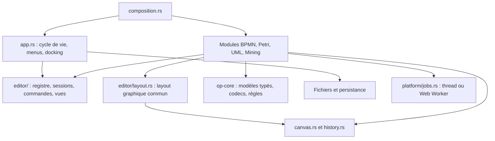

# Architecture actuelle

**Statut : architecture modulaire implémentée après validation du plan.**

La [cible](architecture-cible.md) décrit les principes ; cette page donne les
chemins réellement utilisés. Les changements locaux UML, accueil et identité
visuelle déjà présents ont été conservés pendant la migration.

## Organisation

Le workspace conserve deux crates : `op-core` pour le métier indépendant d'egui,
`op-app` pour l'application native/WebAssembly. `website/` assemble la vitrine
Astro et l'application web sous `/app/`.

## Points d'entrée

| Responsabilité | Implémentation |
| --- | --- |
| Enregistrement statique | [composition.rs](../crates/op-app/src/composition.rs) appelle les fonctions `register` des modules. |
| Descripteurs, fabriques et imports | [editor/registry.rs](../crates/op-app/src/editor/registry.rs). Le registre est injecté dans l'application. |
| Layout graphique commun | [editor/layout.rs](../crates/op-app/src/editor/layout.rs) : configuration, inspecteur, onglets, actions spécifiques et canvas. |
| Session commune et états de vues typés | [editor/session.rs](../crates/op-app/src/editor/session.rs). |
| Nom, destination, état sauvegardé et récupération | [editor/document.rs](../crates/op-app/src/editor/document.rs). |
| Menus, événements et disposition | [app.rs](../crates/op-app/src/app.rs), [home.rs](../crates/op-app/src/home.rs), [dock.rs](../crates/op-app/src/dock.rs). |
| Adaptateurs métier/UI | [BPMN](../crates/op-app/src/bpmn_editor/session.rs), [Petri](../crates/op-app/src/petri_editor/session.rs), [UML](../crates/op-app/src/uml_editor/session.rs), [Mining](../crates/op-app/src/mining_editor/session.rs). |
| Enveloppe et codecs typés | [document/envelope.rs](../crates/op-core/src/document/envelope.rs). |
| Reprise des sessions | [platform/persistence.rs](../crates/op-app/src/platform/persistence.rs). |
| Exécution des tâches | [platform/jobs.rs](../crates/op-app/src/platform/jobs.rs), [tâche Petri](../crates/op-app/src/petri_editor/analysis_job.rs), [worker](../crates/op-app/analysis-worker.js). |

## Documents et vues

Le shell possède des `Doc` contenant un `Box<dyn EditorSession>`. L'ancienne enum
`Editor` n'est plus utilisée. Chaque adaptateur fournit le nom, les commandes,
les exports et les vues de sa notation, et conserve son modèle Rust concret.

`Session<E>` conserve un éditeur et son historique uniques, avec un état typé par
instance de panneau. Les caméras (y compris celle du graphe Petri) et inspecteurs se sauvegardent séparément du
modèle. Les identifiants de vues sont des chaînes extensibles ; les anciennes
valeurs Petri restent lisibles. Fermer une vue parmi plusieurs conserve le document.
La fermeture de sa dernière vue prend en compte les modifications non sauvegardées.

Les anciennes API publiques `document::Model`, `load_any` et `to_json(&Model)`
restent disponibles comme façade de compatibilité. Les chemins communs de
l'application utilisent l'enveloppe ouverte `Document`. Les accès aux éditeurs
concrets par `Any` sont limités aux sondes des tests d'interface, sous `cfg(test)`.

## Découpage des éditeurs

Les dossiers `bpmn_editor/` et `petri_editor/` séparent interactions, rendu,
inspecteur/panneaux et adaptation de session. `uml_editor/` sépare interactions,
rendu, inspecteur et session. `mining_editor/results.rs` contient ses résultats,
et `mining_editor/session.rs` son intégration applicative.

Les noms de modules historiques restent en place : l'arborescence logique de la
cible n'impose pas de déplacer tous les fichiers ni de changer les chemins publics.

## Layout graphique partagé

Les éditeurs BPMN, Petri et UML utilisent `DiagramLayout`. La barre de configuration
partage sa hauteur, son alignement et ses widgets : inspecteur, zoom, aimantation,
affichage des problèmes quand il est disponible et options spécifiques au module.
Les réglages UML ne possèdent plus une deuxième barre de configuration en haut.
Ses actions de relation et d'alignement restent dans l'emplacement d'outils métier.

Le même inspecteur s'affiche à droite dans une vue large. Il est masqué par défaut
sous 760 pixels ; une ouverture explicite dans une vue étroite affiche un panneau
borné au-dessus du canvas. Les onglets BPMN et Petri utilisent le même composant.
La barre regroupe les options dans un menu sous 720 pixels disponibles et y déplace
également le bouton d'inspecteur sous 360 pixels.

L'aimantation, la visibilité de l'inspecteur et l'affichage des problèmes sont des
réglages de vue, enregistrés dans la session. Ils ne modifient pas le modèle `.opx`.
Les styles de dessin persistants restent la propriété des modèles et sont fournis
à la barre par un emplacement d'options spécifique à la notation.

## Historique, sauvegarde et analyses

L'historique par instantanés regroupe les gestes et sait les annuler sans ajouter
une étape. Il couvre aussi le texte et les réponses Mining. Les révisions
sémantiques et graphiques sont distinctes ; revenir à l'état sauvegardé retire
l'indicateur de modification.

L'application écrit les `.opx` v2, lit les v1 et restaure les anciennes sessions
RON dans une nouvelle session JSON v3. Les données d'un fichier inconnu sont
conservées pour récupération. Voir [la compatibilité](documents-et-compatibilite.md).

L'analyse Petri s'exécute sur un instantané privé, en thread natif ou dans un
Web Worker utilisant le même binaire Wasm. Les résultats sont acceptés seulement
pour le même contenu sémantique, la même limite et la même langue. Un déplacement
seul conserve le cache. La fermeture du document abandonne la tâche.

L'annulation native est vérifiée pendant l'exploration et entre les phases ; une
phase d'invariants déjà commencée peut finir en arrière-plan. Le worker web est
terminé directement. Mining et l'évaluation conservent leur exécution actuelle :
le pilote de tâches porte sur Petri, conformément au périmètre du plan.
