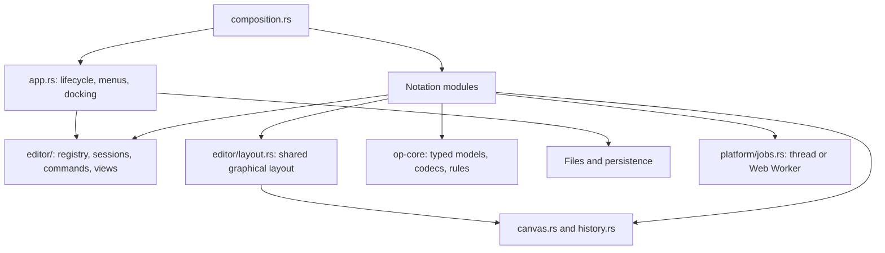

# Current architecture

**Status: modular architecture implemented following approval of the design.**

The [target architecture](architecture-cible.md) records the principles; this page
identifies actual code paths. Existing local UML, home-screen and branding work
was preserved during the migration.

## Organization

The workspace keeps two crates: `op-core` for UI-independent domain code and
`op-app` for the native/WebAssembly application. `website/` assembles the
presentation site and web app under `/app/`.

## Entry points

| Responsibility | Implementation |
| --- | --- |
| Static registration | [composition.rs](../crates/op-app/src/composition.rs) calls each module's `register` function. |
| Descriptors, factories and imports | [editor/registry.rs](../crates/op-app/src/editor/registry.rs); the registry is injected into the app. |
| Shared graphical layout | [editor/layout.rs](../crates/op-app/src/editor/layout.rs): configuration, inspector, tabs, notation actions and canvas. |
| Common session and typed view states | [editor/session.rs](../crates/op-app/src/editor/session.rs). |
| Name, destination, saved state and recovery | [editor/document.rs](../crates/op-app/src/editor/document.rs). |
| Menus, events and docking | [app.rs](../crates/op-app/src/app.rs), [home.rs](../crates/op-app/src/home.rs), [dock.rs](../crates/op-app/src/dock.rs). |
| Domain/UI adapters | [BPMN](../crates/op-app/src/bpmn_editor/session.rs), [Petri](../crates/op-app/src/petri_editor/session.rs), [UML](../crates/op-app/src/uml_editor/session.rs), [Mining](../crates/op-app/src/mining_editor/session.rs). |
| Decision tables and flow editors | [DMN](../crates/op-app/src/dmn_editor.rs), [EPC/activities](../crates/op-app/src/flow_editor.rs). |
| Relational schemas and DDL | [Model](../crates/op-core/src/database.rs), [SQL generation](../crates/op-core/src/database/ddl.rs), [editor](../crates/op-app/src/database_editor.rs). |
| Free drawing | [Model](../crates/op-core/src/whiteboard.rs), [editor](../crates/op-app/src/whiteboard_editor.rs), [session](../crates/op-app/src/whiteboard_editor/session.rs). |
| Mermaid | [Model/SVG](../crates/op-core/src/mermaid.rs), [editor](../crates/op-app/src/mermaid_editor.rs), [preview job](../crates/op-app/src/mermaid_editor/preview.rs). |
| UML class ↔ Mermaid conversion | [Typed conversion](../crates/op-core/src/mermaid/conversion.rs), commands owned by the UML and Mermaid editor adapters; [features and limits](mermaid.md#converting-uml-class-diagrams). |
| Envelope and typed codecs | [document/envelope.rs](../crates/op-core/src/document/envelope.rs). |
| Session restoration | [platform/persistence.rs](../crates/op-app/src/platform/persistence.rs). |
| Automatic document library | [platform/autosave.rs](../crates/op-app/src/platform/autosave.rs), coordinated by [app/automatic.rs](../crates/op-app/src/app/automatic.rs). |
| Background execution | [Jobs](../crates/op-app/src/platform/jobs.rs), [Petri task](../crates/op-app/src/petri_editor/analysis_job.rs), [worker](../crates/op-app/analysis-worker.js). |

## Documents and views

The shell owns `Doc` values containing a `Box<dyn EditorSession>`. The former
`Editor` enum is no longer used. Each adapter supplies its name, commands,
exports and views while retaining a concrete Rust model.

The common creation picker in
[app/new_document.rs](../crates/op-app/src/app/new_document.rs) consumes registry
descriptors and reuses the home-screen card grid. **File → New…**, the tab bar's
**+** and the keyboard shortcut open that picker. The shell has no second
notation list. Session declarations populate **File → Export**.

Each document card has an **Examples** button. `ExampleDescriptor::kind` filters
its menu by canonical document type, and registry validation checks those
references. Factories run only when an example is selected. Selection closes the
picker and opens the example in the originating tab group, like a blank document.

Diagram and workflow descriptors provide an `icon` function. Modules choose
symbols from `icons.rs`; cards do not infer a notation from its order. The same
module provides the shared graphical selection cursor.

The home screen places **Resume your work** before creation cards. Open-document
cards show the name, type, saved state and a PNG preview. They resume the existing
UID rather than making a copy. [app/thumbnails.rs](../crates/op-app/src/app/thumbnails.rs)
captures actual rendered content at 320 × 180 pixels, preserving aspect ratio.
`EditorBackend::thumbnail_rect` identifies the canvas; text/table views fall back
to the displayed panel. Capture changes neither model nor camera. Only one
capture is pending at a time; navigation, dialogs or geometry changes invalidate
a delayed result. Revisions avoid capturing every frame. The preview cache
restores separately; documents without a capture show a type icon.

`Session<E>` owns one editor/history with typed state per panel instance. Cameras,
including the Petri graph camera, and inspectors persist separately from the
model. View identifiers are extensible strings; historical Petri values remain
readable. Closing one of several views preserves the document. Closing its last
view applies the unsaved-change policy.

Legacy `document::Model`, `load_any` and `to_json(&Model)` remain compatibility
facades. Common application paths use the open `Document` envelope. Concrete
editor access through `Any` is restricted to UI probes under `cfg(test)`.

## Editor organization

`bpmn_editor/` and `petri_editor/` separate interaction, rendering, inspector/panels
and session adaptation. `uml_editor/` separates interaction, rendering, inspector
and session. Mining results live in `mining_editor/results.rs`, with integration
in `mining_editor/session.rs`. Historical module names remain; the target's
logical directory tree did not require renaming public paths.

## Shared graphical layout

The [annotated layout and vocabulary](interface.md) name navigation, document
tabs, canvas, inspector and view configuration. Graphical editors use
`DiagramLayout` for shared bar height, spacing, zoom, snapping, issue visibility
where supported and notation-specific slots. UML relation/alignment actions use
the business tools slot rather than a second configuration bar.

The inspector sits on the right in wide views. Below 760 px it is hidden by
default; opening it explicitly places a bounded panel above the canvas. Options
move into a menu below 720 px; the inspector button also moves there below 360 px.
BPMN and Petri share the inspector-tab component.

Snapping, inspector visibility and issue visibility are view preferences, not
`.opx` model content. Persisted drawing styles belong to models and are supplied
through a configuration slot. `theme::toolbar_style` shares button appearance
across toolbars and inspector tabs, independently of domain content and layout.

EPC and UML activity reuse the graphical layout. Their distinct
`Diagram<EpcKind>` and `Diagram<ActivityKind>` types share identity/geometry
mechanisms from `op-core/src/flow.rs` and interaction code in `flow_editor.rs`,
while retaining notation-specific node rules.

DMN has a separate model, evaluator and scrollable table editor. It uses common
shell, history, inspector and action mechanisms without artificial canvas zoom.
See [initial notation limits](notations-ajoutees.md); Looping/Bizagi remain
[product goals](parite-looping-bizagi.md).

Database design has a typed relational model, ERD editor and `database.ddl` view.
Views share tables, keys and history, with local cameras/selections. SQL is
generated in `op-core` for PostgreSQL, MySQL/MariaDB and SQLite. Geometry alone
does not regenerate it. See [the database guide](base-de-donnees-ddl.md).

[Free drawing](dessin-libre.md) uses `whiteboard`, with a model/history independent
of business notations. Stroke points are normalized within element bounds to
preserve direction when moving/resizing. Whiteboard v2 adds typed endpoint
attachments and a module-owned codec that also reads v1. An indexed geometry
resolver computes attached paths for rendering, hit testing, selection, fit and
SVG. Deletion/duplication/movement maintain attachment identities and free
fallback endpoints. It reuses `DiagramLayout` and
`canvas::floating`, registers its example and SVG export in composition, and
keeps cameras/preferences per view. Geometry is semantic content for a drawing.

`geom::Port` supplies preferred rectangle side midpoints and diamond vertices.
BPMN, UML, EPC/activity, Petri transitions and free drawing reuse this geometry;
round event/use-case shapes retain boundary-aware routing. Shared canvas port
guides preview attachment positions without adding another editor catalogue.
Database foreign keys retain their column-row attachments when tables move.

[Mermaid](mermaid.md) registers a source document with asynchronous preview. It
reuses the common inspector and configuration; grid snapping is optional and
absent for this preview because its nodes cannot be dragged.

## Interface languages

English (`en`) is the first-run and fallback language. French (`fr`) and Spanish
(`es`) are available; an explicitly saved choice is restored. The
[core i18n module](../crates/op-core/src/i18n/mod.rs) owns `Lang` and stable message
keys. English lives in `en.rs`; translations live in `fr.rs` and `es.rs`. Missing
translations use English, while unknown keys are displayed unchanged. Tests
check usage, catalogue parity, placeholders and line breaks. See
[translations](traductions.md).

The [UI dropdown](../crates/op-app/src/i18n.rs) displays the current flag/code and
English, Français and Español by native name. Vector flags share egui drawing
code. The preference uses `open-process-lang`, preserving historical serialized
values without changing `.opx` files. The website serves English at `/`, French
at `/fr/` and Spanish at `/es/`, with a language dropdown usable without JavaScript.

## History, saving and analyses

BPMN automatic layout lives in
[bpmn/layout.rs](../crates/op-core/src/bpmn/layout.rs), independent of the UI.
The module exposes `bpmn.auto-arrange` through a `DiagramLayout` option. It is one
undoable history step, updating geometry while preserving pool/lane membership
and domain properties/connections.

Snapshot history groups gestures and can cancel them without adding a step. It
also covers text and Mining answers. Semantic and graphical revisions are
separate; undoing to the saved content removes the modified indicator.

Histories retain at most 200 undo/redo snapshots with a 64 MiB estimated content
budget per document. Size estimates stream serialization at commit time with a
container-overhead allowance. Current models, saved references, gestures and
caches are outside this estimate. Mutation generations let built-in sessions skip
JSON reconstruction on unchanged frames. Commands still force observation;
backends without a generation retain the comparison fallback.

The app writes `.opx` v2, reads v1 and migrates v1/v2 RON and v3 JSON sessions into
the v4 workspace. Automatic copies have stable UUIDs, separate from runtime pane
IDs and manually chosen paths. Native copies live in Documents/Open Process;
browser records live in local storage. The home screen lists closed saved
documents as well as resumable open tabs.

One bounded native writer acknowledges exact submitted snapshots; edits made
during a write remain pending. Close/exit barriers finish older work before
submitting the latest state. Browser storage errors are observed directly rather
than inferred from eframe's error-free storage interface. Web lifecycle handlers
use eframe's whole-application access API to flush before page hiding/unload;
notation editors retain their typed boundary and test-only probes. Workspace v4
references acknowledged copies and retains full payloads for pending changes.
Unknown file bytes remain recoverable. See [compatibility](documents-et-compatibilite.md).

Petri analysis runs on private snapshots through a native worker pool or a Web
Worker using the same Wasm binary. Results match semantic content, limits and
language; geometry-only changes retain that cache. Cancellation is checked during
exploration and inside invariant construction. Uncomputed invariants represent
arithmetic/resource exhaustion rather than wrapped coefficients. Deadlock checks
use actual enabling rules even when successor states were omitted. Structural
classification uses sparse adjacency sets instead of dense matrices.

Mining discovery/soundness, BPMN cost/time evaluation and Mermaid rendering use
the same transport, dispatched in composition. Changed input/language abandons
outdated results. Calculation-scoped translations do not change another thread's
UI language. BPMN evaluation follows history generations, so presentation edits
can also restart its cache.

Native execution uses two reusable threads and eight queued requests, skipping
cancelled requests. Browsers allow four active jobs and terminate a worker on
cancellation or after 30 seconds. Job inputs and transferred results are capped
at 8 MiB. Native calls already inside a rendering library cannot be forcibly
interrupted: the pool bounds concurrency, not every library allocation.

Exploration stores at most 100,000 states, 4,000,000 marking cells and 500,000
edges; smaller user limits still apply. Farkas construction limits live candidate
rows/cells and comparison work before allocation. Mining computes at most 128
activities, 100,000 events and 2 MiB of source, with bounded pair construction;
incomplete discovery is an error. Matrix display is limited to 100,000 cells.
Mermaid preview accepts at most 256 KiB of source; larger drafts can still be
saved/exported as source. These are implementation budgets, not measured latency
or whole-process memory guarantees.
