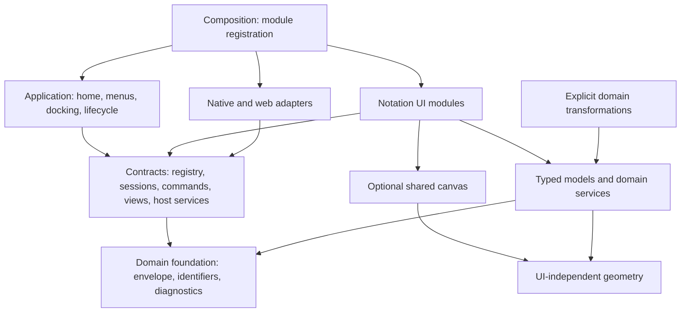
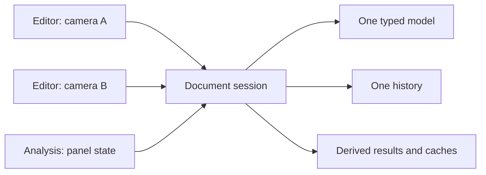

# Target architecture: one application, notation modules

**Status: approved design direction, implemented.**

This page records design principles. The [current architecture](architecture-actuelle.md)
and [extension guide](ajouter-une-notation.md) identify actual interfaces and paths.

## Goal and scope

Adding a document family should require its model, rules, editor, formats and
explicit registration. Menus, home and docking consume declarations rather than
accumulating BPMN/Petri/UML conditionals.

The design keeps a local Rust/egui application for native and WebAssembly use,
covering graphical diagrams, event logs and decision tables. Hot-loaded plugins,
a stable third-party extension API, real-time collaboration and a mandatory
backend are outside this architecture change's scope. Shared-repository product
goals remain a separate future effort.

## Guiding choice: a modular monolith

Notations ship as modules explicitly registered at startup. `op-core` owns domain
code and `op-app` owns the UI. Boundaries begin as Rust modules; extracting crates
remains possible if independent reuse or compilation dependencies justify it.

A module may provide several document types: UML registers `uml.class` and
`uml.use-case` while sharing model/rendering mechanisms. `event-log` is a discovery
document even without a primary canvas.

## Responsibilities and dependencies

Arrows mean “depends on.” Boxes are logical modules, not additional crates.



Composition knows concrete modules and wires services. The shell and contracts
do not import them. Editors issue requests handled after rendering rather than
accessing application internals, following the docking event mechanism.

Useful domain dependencies remain explicit: Alpha produces a Petri net and a
BPMN/Petri transformation depends on both models. This creates no dependency
between their editors. A module need not depend on the entire catalogue to name
or inspect its own document.

## Integration contracts

These names describe responsibilities; implemented signatures live in
`op-app/src/editor/`, using dyn-compatible interfaces at the UI boundary.

| Contract | Responsibility |
| --- | --- |
| `DiagramDescriptor` | Stable type ID, translatable labels, category, icon and empty-document creation. |
| `DiagramRegistry` | Deterministic descriptors/opening factories and duplicate ID validation. |
| `EditorSession` | A live document: typed model, history, commands, views and saveable snapshots. |
| `CommandDescriptor` / `enabled` | Command identity/presentation and availability for the current document, selection and mode. |
| `ViewDescriptor` | Available views: editor, matrices, analysis, results, etc. |
| `DocumentCodec<M>` | Typed domain decoding, validation, migration and persistence encoding. |
| `ImportDescriptor` / `ExportDescriptor` | Available formats/operations; file transport remains a host service. |
| Platform adapters / `HostEvent` | Targeted requests to open documents/views, export files, run computations or display diagnostics. |

The shell owns documents through a common interface such as
`Box<dyn EditorSession>`. Inside each module, models and histories remain concrete
Rust types. Serialization uses an explicit codec, not direct trait-object Serde.

The codec belongs to `op-core` and is independent of egui. A registered UI factory
calls it and constructs a concrete session, so the shell needs neither a central
model enum nor `Any` conversion. Command-line tools can use the same typed codec
without loading the app. Sessions and view contracts remain in `op-app`.

Technical IDs such as `petri.analysis` and `bpmn.convert-to-petri` are independent
of translations and menu positions. The registry describes content; the app
controls its order and presentation.

## Lifecycle: one document, multiple views



The app owns document identity, save destination and open panels. The session
owns the single mutable model. Panels reference the document, a view type and a
view-instance ID. Camera, zoom and inspector tab belong to the view instance.
Typed view state may live in the session under those IDs; the shell need not
know its internal types. Selection may be shared, but active gestures remain
local and only one editing transaction applies at a time.

Showing a diagram twice duplicates neither model nor history. Closing a panel
releases view state. The shell handles document closure and unsaved changes.

## Model, history and invalidation

Persistent content includes domain data and edited presentation: positions,
sizes and styles. A move is saveable and undoable. Camera, selection, dialogs,
caches and active animation belong to workspace state.

Mutations use module transactions: begin gesture, mutate, commit or cancel. A
continuous drag produces one history step; inspectors and commands use the same
mechanism. Snapshot history remains the first choice; deltas require measurements.

Separate revisions track semantic content and presentation. Analyses follow their
actual dependencies, so a move alone does not invalidate structural analysis.
Undo/redo invalidates affected results like other mutations. File schema versions
are independent of these revisions.

Modified state compares persistent content with the last successful save, by
equality or deterministic fingerprint. A revision counter alone is insufficient:
undoing back to saved content must remove the indicator. Failed or cancelled
saves do not update the saved reference.

## Canvas and notation-specific rules

The canvas shares coordinate transforms, navigation, grid, drawing primitives,
selection tools and movement mechanisms. Modules supply shapes, hit testing,
anchors and movement/connection constraints.

UI-independent routing can remain in domain/geometry code, with notation-specific
policy. Petri properties should not become a universal style imposed on unrelated
diagrams. A BPMN gateway, Petri transition and UML association retain distinct
invariants. A shared graph is a local option justified by concrete uses. A DMN
table must integrate with documents, commands and files without a canvas.

`DiagramLayout` also shares the inspector, tabs, configuration bar and canvas
space. Modules pass common controls and domain content instead of redefining
styles or breakpoints for grid, zoom and issues. Inapplicable options stay absent;
notation-specific tools use a dedicated slot.

## Long computations and conversions

Algorithms remain UI-independent domain functions. A job service runs snapshots
with limits, cancellation and diagnostics. Results identify their document and
input revisions; stale results cannot replace newer analyses or revive a closed
document.

Native platforms can use background tasks. Browsers need a worker or incremental
computation that regularly yields: wrapping expensive synchronous work in
`spawn_local` is insufficient. The Petri pilot uses a native thread or Web Worker
with the same Wasm binary; see the current architecture for limits.

Conversions appear as workflow commands. A domain service produces a typed model
and diagnostics; composition connects it to the target module. The shell receives
a generic open request, keeps the source and displays reported approximations.

## Proposed logical tree

This is a responsibility map, not the current file tree. Existing module names
were preserved during extraction; use the current architecture for real paths.

```text
crates/op-core/src/
  shared/            # geometry, IDs, diagnostics, document envelope
  notations/
    bpmn/            # model, validation, evaluation, XML, migrations
    petri/           # model, analysis, PNML, migrations
    uml/             # class/use-case models, validation, routing, codecs
    mining/          # logs, Alpha, exercises, replay, codecs
  transforms/        # domain transformations between models

crates/op-app/src/
  composition.rs     # explicit registration and workflow wiring
  shell/             # application, home, menus, documents, docking
  editor/            # contracts, registry, commands, views, host services
  features/
    bpmn/            # session, interaction, rendering, inspector, panels
    petri/
    uml/
    mining/
  canvas/            # shared graphical mechanisms
  platform/          # files, persistence, images, job execution
  ui/                # theme, widgets, interface translation
```

Existing public `op-core` paths need not disappear; re-exports can preserve
consumers. Existing domain diagnostics can progressively move to codes/parameters
translated at presentation time without blocking the pilot.

## Successful extension criterion

A new notation should change its domain module, UI adapter, tests/resources,
`mod`/export declarations and composition entry. Menus, home and docking work
from existing descriptors. Changes to the shared foundation are legitimate when
a notation reveals a reusable need, but must be explicit and tested against
existing notations. Demonstrate the boundary before expanding the contract.
