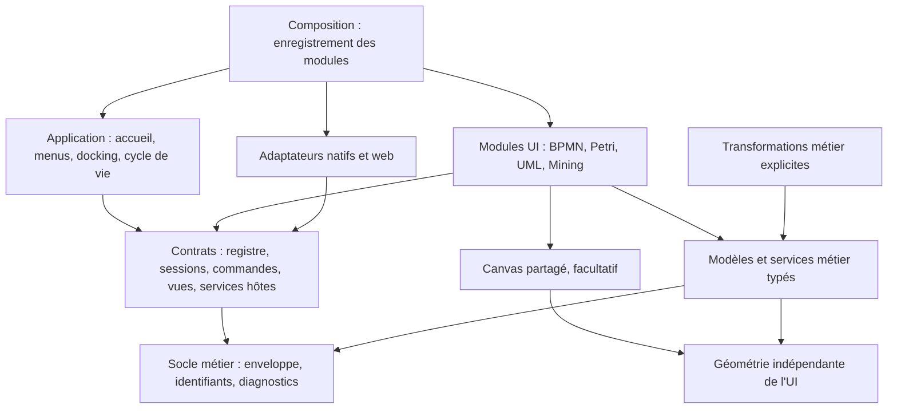
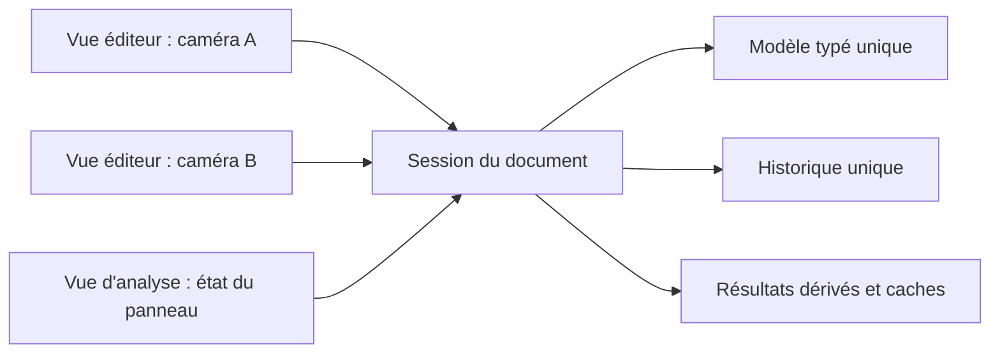

# Architecture cible : une application, des modules par notation

**Statut : direction validée et implémentée.**

Cette page conserve les principes de conception ; [l'architecture actuelle](architecture-actuelle.md)
et le [guide d'ajout](ajouter-une-notation.md) donnent les interfaces et chemins réels.

## Objectif et périmètre

Ajouter une famille de documents doit demander son modèle, ses règles, son éditeur,
ses formats et un enregistrement explicite. Les menus, l'accueil et le docking
doivent exploiter ces déclarations, sans multiplier les conditions BPMN/Petri/UML.

La cible conserve une application Rust/egui, native et WebAssembly, utilisable
localement. Elle couvre les diagrammes graphiques, les journaux d'événements et
de futures tables de décision. Les plugins chargés à chaud, une API d'extensions
tierces stable, la collaboration temps réel et un backend obligatoire sont hors
du périmètre proposé.

## Choix directeur : un monolithe modulaire

Les notations sont des modules livrés avec le produit, enregistrés explicitement
au démarrage. `op-core` conserve le métier et `op-app` l'interface. Les frontières
sont d'abord des modules Rust ; extraire des crates restera possible si une
réutilisation indépendante ou les dépendances de compilation le justifient.

Un module peut proposer plusieurs types de documents. Le module UML peut ainsi
enregistrer `uml.class` et `uml.use-case`, tout en partageant ses modèles et son
rendu. `event-log` représente un document de découverte, même sans canvas principal.

## Responsabilités et dépendances

Dans ce schéma, une flèche signifie « dépend de ». Les blocs représentent des
modules logiques, pas des crates supplémentaires.



La composition est l'endroit qui connaît les modules concrets et injecte les
services. Le shell et les contrats ne les importent pas. Les éditeurs n'accèdent
pas à la structure interne de l'application ; ils émettent des demandes traitées
après le rendu, dans l'esprit des événements de docking actuels.

Les dépendances métier utiles restent explicites : Alpha peut produire un réseau
de Petri ; une transformation BPMN/Petri dépend des deux modèles. Ces dépendances
ne créent aucun import entre leurs éditeurs. Un module ne dépend pas de la
totalité du catalogue pour obtenir le nom ou le contenu de son propre document.

## Contrats d'intégration

Les noms suivants désignent des responsabilités. Les signatures implémentées sont
dans `op-app/src/editor/`, avec des interfaces compatibles avec `dyn` à la frontière UI.

| Contrat | Responsabilité |
| --- | --- |
| `DiagramDescriptor` | Identifiant stable du type, libellés traduisibles, catégorie, icône et création d'un document vide. |
| `DiagramRegistry` | Catalogue déterministe des descripteurs et fabriques d'ouverture ; contrôle des doublons d'identifiants. |
| `EditorSession` | Une instance vivante de document : modèle typé, historique, commandes, vues et production d'un instantané sauvegardable. |
| `CommandDescriptor` / `enabled` | Identité et présentation d'une commande, disponibilité selon le document, la sélection et le mode courant. |
| `ViewDescriptor` | Types de vues proposés par une session : éditeur, matrices, analyse, résultats, etc. |
| `DocumentCodec<M>` | Contrat métier typé : décoder, valider et migrer le contenu d'une notation ; encoder son état persistant. |
| `ImportDescriptor` / `ExportDescriptor` | Formats et opérations disponibles ; le transport de fichiers reste un service hôte. |
| Adaptateurs de plateforme / `HostEvent` | Demandes ciblées : ouvrir un document, exporter un fichier, ouvrir une vue, lancer un calcul, afficher un diagnostic. |

Le shell possède des documents derrière une interface commune, par exemple
`Box<dyn EditorSession>`. À l'intérieur, chaque module conserve un modèle Rust
concret et son historique typé. La sérialisation passe par un codec explicite ;
on ne demande pas à Serde de sérialiser directement un objet trait.

Le contrat de codec appartient au socle documentaire d'`op-core` et reste
indépendant d'egui. Chaque notation l'applique à son type `M`. La fabrique UI
enregistrée appelle ce codec puis construit la session concrète : le shell n'a
besoin ni d'un enum regroupant tous les modèles ni d'une conversion dynamique
par `Any`. Un outil en ligne de commande peut utiliser le même codec typé sans
charger l'application. Les contrats de sessions et de vues restent dans `op-app`.

Les identifiants techniques, comme `petri.analysis` ou `bpmn.convert-to-petri`,
ne dépendent ni des traductions ni des positions dans un menu. Le registre
décrit le contenu ; l'application garde la maîtrise de son ordre et de sa présentation.

## Cycle de vie : un document, plusieurs vues



L'application possède l'identifiant du document, sa destination de sauvegarde et
les panneaux ouverts. La session possède le modèle mutable unique. Chaque panneau
référence le document, un type de vue et un identifiant d'instance de vue.

La caméra, le zoom et l'onglet d'inspecteur appartiennent à l'instance de vue.
Les états propres aux vues peuvent rester stockés dans la session sous ces
identifiants : le shell n'a pas à connaître leurs types internes. Une sélection
partagée entre vues d'un même document est possible ; les gestes en cours restent
locaux et une seule transaction d'édition s'applique au document à la fois.

Afficher le même diagramme dans deux panneaux ne duplique ni son modèle ni son
historique. Fermer un panneau libère son état de vue. Le shell applique la politique
de fermeture du document, avec prise en compte des modifications non sauvegardées.

## Modèle, historique et invalidation

Le contenu persistant comprend le métier et la présentation éditée du diagramme
(positions, tailles, style). Un déplacement se sauvegarde et peut être annulé.
La caméra, la sélection, les dialogues, les caches et une animation en cours
relèvent de la session de travail.

Toute modification passe par une transaction du module : début du geste, mutations,
validation ou annulation. Un déplacement continu produit une étape d'historique.
L'inspecteur et les commandes utilisent le même mécanisme. L'historique par
instantanés reste le premier choix ; des deltas ne se justifieront qu'après mesure.

Des révisions distinctes suivent le contenu sémantique et la présentation. Les
analyses suivent les révisions dont elles dépendent ; les déplacements seuls
n'invalident pas une analyse structurelle. Annuler/refaire invalide les résultats
concernés comme toute mutation. Les versions de schéma de fichier sont indépendantes.

L'état « modifié » compare l'état persistant au dernier état sauvegardé avec succès,
par égalité ou empreinte déterministe. Un compteur de révision seul ne suffit pas :
annuler jusqu'à cet état doit retirer l'indicateur de modification. Une sauvegarde
échouée ou annulée ne change pas la référence sauvegardée.

## Canvas et règles propres aux notations

Le canvas partage les transformations de coordonnées, la navigation, la grille,
les primitives de dessin, les outils de sélection et les mécanismes de déplacement.
Le module fournit les formes, la détection des éléments sous le pointeur, les
ancrages et les contraintes de déplacement et de connexion.

Les algorithmes de routage indépendants d'egui peuvent rester dans le métier ou
la géométrie. Leur politique appartient à la notation. Les propriétés Petri ne
doivent pas entrer dans un style universel imposé aux futurs diagrammes.

Les modèles restent spécialisés : une passerelle BPMN, une transition Petri et
une association UML ont des invariants propres. Le partage d'un graphe générique
est une possibilité locale, à justifier par des usages réels. Une table DMN doit
pouvoir se brancher aux documents, commandes et fichiers sans implémenter de canvas.

Le chrome des éditeurs graphiques est lui aussi commun : `DiagramLayout` gère
l'inspecteur, ses onglets, la barre de configuration et l'espace du canvas. Les
modules passent des références aux contrôles communs et des contenus métier ;
ils ne redéfinissent pas leurs propres styles ou seuils de mise en page pour la
grille, le zoom ou l'affichage des problèmes. Les options sans équivalent dans
une notation restent absentes. Les outils spécifiques utilisent un emplacement dédié.

## Calculs longs et conversions

Les algorithmes restent des fonctions métier indépendantes de l'UI. Un service
de tâches les exécute sur un instantané avec limites, annulation et diagnostics.
Chaque résultat porte l'identifiant du document et les révisions de ses entrées ;
un résultat périmé ne remplace pas une analyse récente et ne réactive pas un document fermé.

Le natif peut utiliser des tâches en arrière-plan. Le navigateur exige un worker
ou un calcul découpé qui rend régulièrement la main : `spawn_local` autour d'un
calcul synchrone coûteux ne suffit pas. Le pilote Petri utilise désormais un thread natif ou un Web Worker avec le même
binaire Wasm. Voir les détails et limites dans l'architecture actuelle.

Les conversions s'intègrent comme des commandes de workflow. Le service métier
produit un modèle typé et des diagnostics ; la composition raccorde ce résultat
au module cible. Le shell reçoit une demande générique d'ouverture. Il conserve
le document source et présente les approximations signalées par la transformation.

## Arborescence logique proposée

Cette arborescence représente les responsabilités logiques. Les modules historiques
ont été conservés pendant les extractions ; les chemins réels sont dans l'architecture actuelle.

```text
crates/op-core/src/
  shared/            # géométrie, identifiants, diagnostics, enveloppe documentaire
  notations/
    bpmn/            # modèle, validation, évaluation, XML et migrations
    petri/           # modèle, analyses, PNML et migrations
    uml/             # classes/cas d'utilisation, validation, routage et codecs
    mining/          # logs, Alpha, exercices, replay et codecs
  transforms/        # transformations métier entre modèles

crates/op-app/src/
  composition.rs     # enregistrement explicite et raccordement des workflows
  shell/             # application, accueil, menus, documents, docking
  editor/            # contrats, registre, commandes, vues, services hôtes
  features/
    bpmn/            # session, interactions, rendu, inspecteur, panneaux
    petri/
    uml/
    mining/
  canvas/            # mécanismes graphiques mutualisés
  platform/          # fichiers, persistance, images, exécution des tâches
  ui/                # thème, widgets et traduction de l'interface
```

Le découpage ne demande pas de supprimer immédiatement les chemins publics
actuels d'`op-core` : des réexportations peuvent préserver ses consommateurs.
La traduction des diagnostics métier existants peut évoluer progressivement vers
des codes et paramètres traduits à la présentation, sans bloquer le pilote.

## Critère d'extension réussi

Pour une nouvelle notation, les changements attendus sont son module métier, son
adaptateur UI, ses tests et ressources, ses déclarations `mod`/exports et son entrée
dans la composition. Les boucles de menus, l'accueil et le moteur de docking
fonctionnent à partir des descripteurs existants.

Une modification du socle commun reste légitime si la notation révèle un besoin
réutilisable nouveau. Elle doit alors être explicite et testée avec les notations
déjà présentes. Le pilote doit démontrer cette frontière avant d'étendre le contrat.
