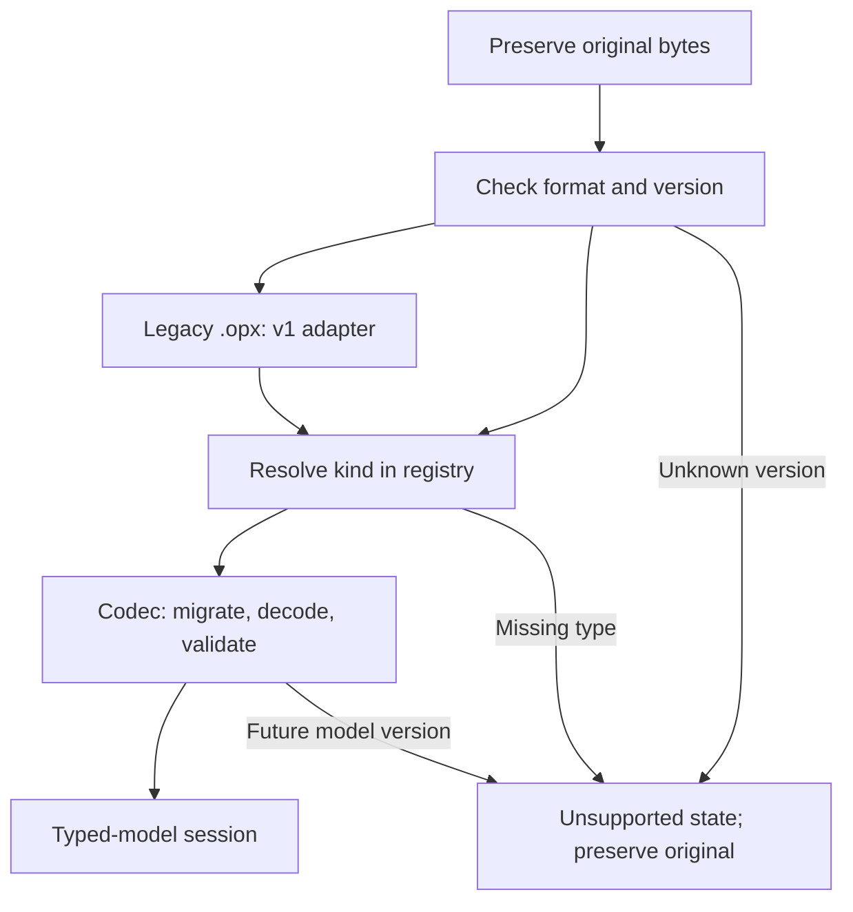

# Documents, saving and compatibility

**Status: implemented. The app writes `.opx` v2 and reads v1.**

The legacy `document::to_json(&Model)` facade still writes v1 for existing
consumers. The new path uses `Document::to_json()`. This page details storage for
the [target architecture](architecture-cible.md); changing the format was a
separate [migration step](migration.md).

## Three kinds of state

| State | Examples | Persistence |
| --- | --- | --- |
| Document content | Nodes, links, text, exercise answers, name, positions, sizes, styles. | `.opx` files and session restoration. |
| Workspace | Open documents, active panel, layout, cameras, inspector tabs. | Separate session persistence. |
| Transient/derived state | Active drag, analysis cache, animation, job progress. | Rebuilt or reset. |

Simulation state does not replace the saved initial marking. An explicit action
may change it like any other domain edit. Exported analysis results are computed
outputs, not another source of truth.

## The `.opx` v2 envelope

The historical v1 envelope contains `format`, `version` and `model`, with the
model represented by a `Model` enum variant. The open v2 envelope is:

```json
{
  "format": "open-process",
  "version": 2,
  "document": {
    "kind": "uml.class",
    "model_version": 1,
    "model": {}
  }
}
```

The abbreviated `model` illustrates the envelope; it is not a complete diagram.
Implementation is in [document/envelope.rs](../crates/op-core/src/document/envelope.rs).
Historical fixtures remain in `op-core/tests/fixtures/v1/`.

- `version` identifies the envelope schema.
- `kind` is a stable registered type ID, independent of UI labels.
- `model_version` identifies the notation's schema.
- `model` contains its serialized typed model, including persistent presentation.

Initial IDs include `bpmn`, `petri`, `uml.class`, `uml.use-case` and `event-log`.
Subsequent modules register `dmn.table`, `epc`, `uml.activity`, `database.schema`,
`whiteboard` and `mermaid`. Mermaid model v1 stores its name/source and allows
invalid drafts; rendered previews are not saved. Each type's codec owns its model
version. IDs written to files become compatibility contracts.

Codecs encode/decode concrete models. The shell handles the envelope/session
without extracting domain fields. Generic JSON is limited to this boundary,
not passed into domain algorithms.

## Loading and migration



The reader supports historical files; the app writes v2. The adapter maps `Bpmn`,
`Petri` and `Log` to stable IDs, and distinguishes UML class/use-case content.
Migrations deterministically produce validated models or explicit errors.

Opening an old file does not rewrite it. In-memory migration becomes persistent
only on an explicit save. New files must reopen, but older application versions
are not guaranteed to read them.

Missing types and future versions must not become empty documents or overwrite
inputs. The app preserves original bytes, explains the limitation and allows
recovery. Decode errors for supported formats are distinguished from unsupported formats.

## Imports and exports

Native codecs are identified by `kind`. External importers declare extensions,
content probes and possible results. Detection is deterministic: extensions alone
do not force parsers; two credible candidates produce explicit ambiguity.
Unknown XML is not assumed to be BPMN, nor arbitrary text a valid log.

Registered formats supply dialog filters. Exporters describe losses/limitations;
PlantUML export does not imply import. Modules produce export bytes; platform
services write files or trigger downloads.

## Workspace persistence

Legacy RON keys `open-process-v1` and `open-process-v2` evolve separately from
`.opx`. JSON under `open-process-v3` stores document envelopes/IDs, panel
references and view states with appropriate validation.

Restoration reads old keys without deleting them. New data is written only after
successful migration. Failure or missing modules must leave recoverable data;
a missing view uses a fallback without losing the document. A file destination
alone does not prove a document was saved: restored documents remain marked
unsaved when the actual saved state is unknown.

## Home preview cache

The optional `open-process-thumbnails-v1` key stores PNG previews of open documents,
separately from sessions and `.opx`. Saving caps the cache at 64 entries and
512 KiB of PNG data. Restoration remaps IDs; content fingerprints prevent previews
being reused for a different document revision.

Missing, malformed, stale or invalid PNG entries are ignored. Image dimensions
are checked before decoding. Cards show type icons until recaptured. These are
derived data: missing previews block neither restoration nor saving, and change
neither the session schema nor `.opx` format.

## Guarantees checked during migration

- v1 fixtures for BPMN, Petri, logs and both UML types with meaningful content.
- Reading, migration and round trips preserving supported fields.
- Controlled rejection of invalid envelopes, missing types and future versions.
- Original preservation and no automatic rewrite on opening.
- v1/v2 session restoration and multiple panels for one document.
- Cancelled/failed saves preserving modified state on native and web paths.

See [verification records](verification.md) for the scope of those checks.
