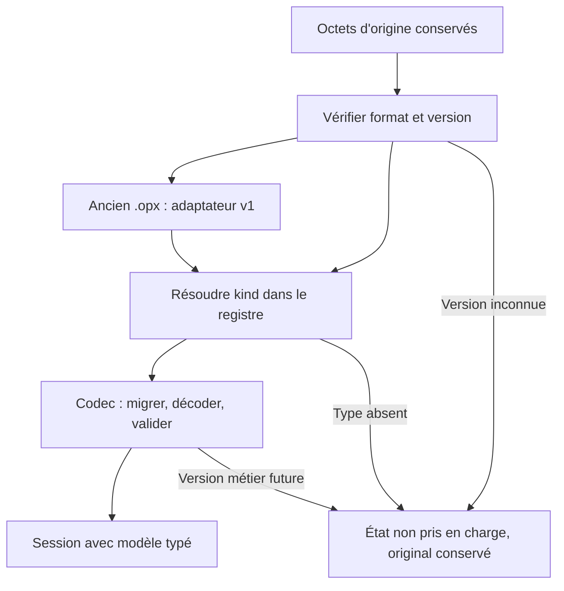

# Documents, sauvegarde et compatibilité

**Statut : implémenté. L'application écrit les `.opx` v2 et lit les v1.**

La façade historique `document::to_json(&Model)` conserve son écriture v1 pour ses
consommateurs existants. Le nouveau chemin utilise `Document::to_json()`.

Cette page précise le stockage de [l'architecture cible](architecture-cible.md).
La modification du format est une étape distincte du [plan de migration](migration.md).

## Séparer trois états

| État | Exemples | Persistance envisagée |
| --- | --- | --- |
| Contenu du document | Nœuds, liens, texte, réponses d'exercice, nom, positions, tailles, style. | Fichier `.opx` et reprise de session. |
| Espace de travail | Documents ouverts, panneau actif, disposition, caméras et onglets d'inspecteur. | Persistance de session séparée. |
| État transitoire ou dérivé | Glissement en cours, caches d'analyse, animation, progression d'une tâche. | Reconstruit ou réinitialisé. |

Les états de simulation ne remplacent pas le marquage initial sauvegardé. Une
action explicite peut modifier celui-ci, comme toute édition métier. Les résultats
exportés d'une analyse sont des sorties calculées, pas une deuxième source de vérité.

## Enveloppe `.opx` v2

L'enveloppe actuelle contient `format`, `version` et `model`, dont le type est
une variante de l'enum `Model`. L'enveloppe v2 porte :

```json
{
  "format": "open-process",
  "version": 2,
  "document": {
    "kind": "uml.class",
    "model_version": 1,
    "model": {}
  }
}
```

Le contenu de `model` est raccourci ici : cet exemple illustre l'enveloppe et
n'est pas un diagramme complet ouvrable. Les champs sont implémentés dans `document/envelope.rs` et les fixtures v1 sont
conservées dans `op-core/tests/fixtures/v1/`.

- `version` décrit le schéma de l'enveloppe.
- `kind` est l'identifiant stable d'un type enregistré, indépendant de l'UI.
- `model_version` décrit le contenu de cette notation.
- `model` contient son modèle typé sérialisé, y compris sa présentation persistante.

Les identifiants enregistrés sont `bpmn`, `petri`, `uml.class`, `uml.use-case` et
`event-log`. Le module UML peut partager son implémentation pour les deux types.
Une fois écrits dans des fichiers, ces identifiants deviennent un contrat de compatibilité.

Le codec encode et décode le modèle concret. Le shell manipule l'enveloppe et la
session ; il n'extrait pas lui-même les champs métier. Une représentation JSON
générique est limitée à cette frontière, pas propagée aux algorithmes métier.

## Chargement et migrations



Le lecteur prend en charge les anciens fichiers ; l'application utilise l'écriture v2.
L'adaptateur transforme `Bpmn`, `Petri` et `Log` vers leurs identifiants. Pour
`Uml`, il distingue `Class` et `UseCase` à partir du contenu existant. Chaque
migration est déterministe et produit un modèle validé ou une erreur explicite.

Ouvrir un ancien fichier ne le réécrit pas. La migration en mémoire devient
persistante lors d'une sauvegarde demandée par l'utilisateur. Le nouveau fichier
doit pouvoir être rouvert ; sa lecture par les anciennes versions de l'application
n'est pas garantie et cette limite doit être annoncée lors de l'adoption du format.

Un type absent ou une version future ne doit pas produire un document vide, ni
écraser l'entrée. L'application conserve les octets originaux et explique la limite,
avec possibilité de récupérer l'original. Les erreurs de décodage d'un document
pris en charge sont distinguées des formats non pris en charge.

## Imports et exports

Les codecs natifs sont identifiés par `kind`. Les importeurs de formats externes
déclarent extensions, indices de contenu et résultat possible. La détection est
déterministe : une extension seule ne force pas un parseur ; deux candidats
crédibles produisent une ambiguïté explicite. Le moteur de détection ne suppose
pas que tout XML inconnu est du BPMN ni que tout texte est un log valide.

Les filtres de dialogue sont construits depuis les formats enregistrés. Les
exporteurs annoncent leurs limites et leurs pertes éventuelles. La prise en charge
d'un export PlantUML n'implique pas celle de son import. Les modules produisent
des données à exporter ; les services de plateforme effectuent l'écriture ou le téléchargement.

## Persistance de l'espace de travail

Les anciennes clés RON `open-process-v1` et `open-process-v2` ont leur propre évolution,
distincte de la version du fichier `.opx`. Le schéma JSON sous `open-process-v3` stocke les
enveloppes de documents, leurs identifiants, les références de panneaux et les
états de vues, chacun avec une validation adaptée.

La restauration lit les anciennes clés sans les détruire. La nouvelle représentation
n'est écrite qu'après une migration réussie. Une panne ou un module indisponible
laisse les données récupérables ; une vue disparue utilise une vue de secours du
module sans perdre le document. La destination d'un fichier n'est pas une preuve
qu'il a été sauvegardé : les documents restaurés restent signalés à sauvegarder
si leur état réellement sauvegardé n'est pas connu.

## Garanties vérifiées par la migration

- Fixtures `.opx` v1 pour BPMN, Petri, logs et les deux types UML, avec données significatives.
- Lecture, migration et aller-retour vers le nouveau format sans perte des champs pris en charge.
- Refus contrôlé des mauvaises enveloppes, des types absents et des versions futures.
- Préservation de l'original et absence d'écriture automatique à l'ouverture.
- Reprise des sessions v1/v2 et de plusieurs panneaux du même document.
- Sauvegarde annulée ou échouée qui conserve l'état modifié, sur natif et web.
