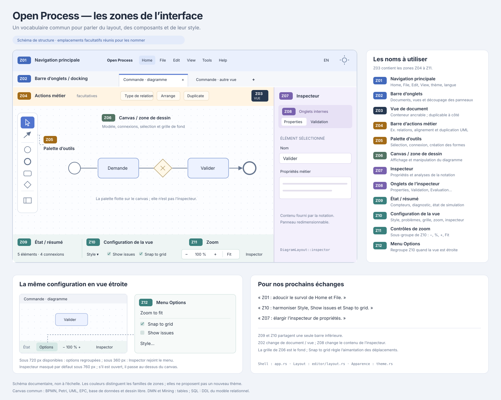

# Zones et composants de l’interface

**Statut : repères de l’interface implémentée et pistes de bibliothèques.**

Ouvrir le [layout SVG annoté](diagrams/interface-zones.svg) pour désigner une zone
par son nom ou son identifiant, par exemple « Z10 : modifier le survol du bouton
Style ». Le SVG est un document vectoriel modifiable, avec un groupe identifié
pour chacune des douze zones.

Le schéma réunit les emplacements facultatifs afin de les nommer : une notation
n’affiche pas nécessairement tous les composants. Les proportions et les couleurs
servent à lire la structure. Le SVG ne propose pas de déplacer les panneaux ni
d’adopter ces couleurs dans le produit.

## Vocabulaire commun

| Repère | Nom | Rôle et propriétaire |
| --- | --- | --- |
| Z01 | Navigation principale / barre de menus | Home, File, Edit, View, Tools, Help, langue et thème. Shell : `app.rs::menu_bar`. |
| Z02 | Barre d’onglets / docking | Documents et vues ouvertes, fermeture et division de l’espace de travail. `DockBehavior` dans `app.rs`, arbre dans `dock.rs`. |
| Z03 | Vue de document / panneau ancrable | Conteneur affiché dans une zone du docking. Plusieurs vues peuvent partager le même document et son historique. |
| Z04 | Barre d’actions métier | Actions propres à la notation, par exemple le type de relation et l’alignement UML. Emplacement commun : `DiagramLayout::tools`. |
| Z05 | Palette d’outils | Choix de l’outil courant : sélectionner, connecter, créer une forme. Contenu fourni par la notation et primitives dans `canvas.rs`. |
| Z06 | Canvas / zone de dessin | Dessin du modèle, grille de fond, sélection, déplacement et caméra. Emplacement `DiagramLayout::canvas`. |
| Z07 | Inspecteur | Propriétés, validation ou analyses de la notation. Cadre et adaptation à la largeur : `DiagramLayout::inspector`. |
| Z08 | Onglets de l’inspecteur | Change le contenu de Z07, par exemple Properties / Validation / Evaluation. `DiagramLayout::inspector_tabs`. |
| Z09 | État / résumé | Compteurs, diagnostic, état de simulation. Contenu `FooterStatus` affiché dans `DiagramLayout::configuration`. |
| Z10 | Configuration de la vue | Style, Show issues, Snap to grid, zoom et affichage de l’inspecteur. `DiagramLayout::configuration`. |
| Z11 | Contrôles de zoom | Sous-groupe de Z10 : diminuer, pourcentage/réinitialisation, augmenter et cadrer. `canvas::zoom_controls` et `zoom_buttons`. |
| Z12 | Menu Options compact | Regroupe les options de Z10 dans une vue étroite. Même composant de configuration. |

Z09 et Z10 sont deux groupes d’une **seule barre inférieure**. Z11 appartient à
Z10. Z02 et Z08 ont des responsabilités différentes : les premiers onglets
changent de document ou de vue ; les seconds changent le contenu de l’inspecteur.
La grille visible dans Z06 est le fond du canvas ; « Snap to grid » règle
l’aimantation des déplacements.

Petri places use a model-space radius of 8.25 units, a diameter of 16.5 before
zoom, following the later 50% increase. Tokens scale with the radius; arc anchors,
creation previews and hit testing use the same value. Place labels keep their text size.
Historical radius changes in the verification record refer to earlier revisions.

Le bouton « + » de Z02, **File → New…** et **Ctrl/Cmd+N** ouvrent le même
sélecteur de documents : une grille de cartes issue du registre, avec recherche,
défilement et adaptation à la largeur. Cette grille réutilise les composants
de l’accueil. Choisir une carte crée le document ; annuler ou appuyer sur Échap
ferme le sélecteur. Depuis un groupe d’onglets partagé, le nouveau document
est créé dans le groupe à l’origine de l’action.
Chaque carte de type de diagramme propose son bouton **Exemples**, en bas à
droite, avec uniquement les exemples de ce type. Le même composant est utilisé
dans l’accueil et le sélecteur. Les cartes sans exemple et les lanceurs de
workflow gardent leur action principale. Choisir un exemple ferme le sélecteur
et conserve le groupe d’onglets à l’origine de l’ouverture. Ouvrir le menu
d’exemples ne crée pas de document vierge.

Dans l’accueil, **Reprendre votre travail** apparaît avant **Nouveau document**
lorsque des documents sont ouverts. Chaque carte présente un aperçu PNG, le nom
sur une ligne, l’icône et le type de notation, ainsi que **Non enregistré** quand
des modifications restent à sauvegarder. Le nom complet est accessible au survol.
Un clic ou une activation clavier reprend le document et son historique existants.
La grille utilise une à quatre colonnes selon la largeur disponible.

Les aperçus sont des captures locales du contenu affiché, réduites à 320 × 180
pixels avec conservation des proportions. Les vues graphiques capturent leur
canvas ; les tables et journaux utilisent leur panneau. Ils reflètent la vue
affichée, avec ses éventuelles sélections et palettes, sans imposer de recadrage
à l’utilisateur. Une icône remplace l’aperçu avant la première capture. Les PNG
sont réutilisés et conservés avec les préférences de l’application, dans un cache
séparé des documents.

Les pictogrammes des cartes représentent leur notation : événement/tâche/passerelle
BPMN, places et transition Petri, classes reliées, acteur/cas d’utilisation,
table DMN, chaîne EPC, branche d’activité UML, tables relationnelles ou crayon.
Chaque module déclare sa fonction `icon` dans son descripteur ; le tri et la
recherche conservent cette identité. Les workflows déclarent également leur icône.
Les dessins vectoriels communs se trouvent dans
[`icons.rs`](../crates/op-app/src/icons.rs).

Les palettes des éditeurs graphiques partagent le curseur de sélection issu de
BPMN. La palette verticale du dessin libre utilise aussi des pictogrammes pour la
main, les formes, les lignes, le crayon, le texte et les notes. Les boutons
conservent leurs noms accessibles, infobulles et état sélectionné.
Elle flotte à gauche du canvas, comme les palettes BPMN et Petri, avec
défilement vertical lorsque les outils dépassent la hauteur disponible.

Dans BPMN, les menus contextuels **Task type** et **Gateway type** affichent
une icône à gauche de chaque choix et mettent en évidence le type courant.
Les listes correspondantes de l’inspecteur réutilisent ces mêmes lignes.
Les marqueurs de tâches sont ceux du canvas ; les passerelles réutilisent
son dessin vectoriel (XOR, AND, OR, événementielle ou complexe). Les commandes
de création par clic droit dans le vide disposent également d’une icône.
Le bouton complet reste cliquable, avec un libellé accessible ; le pictogramme
est décoratif et suit la couleur du texte pour le thème et la sélection.

Dans Z01, les formats d’export sont regroupés dans **File → Export**. Le contenu
de ce sous-menu provient de la session du document actif, avec le PNG lorsque
la vue permet la capture. L’export est désactivé depuis l’accueil.

Pour BPMN, Z10 propose **Auto arrange** à côté des options de style. Dans une
vue compacte, l’action rejoint le menu Z12. Elle dispose les éléments de gauche
à droite, conserve les pools/couloirs et recadre la vue active. La disposition
est sauvegardée dans le document et peut être annulée/rétablie. Les largeurs
de pools et hauteurs de couloirs peuvent augmenter pour accueillir les éléments.
Les géométries invalides et les éléments situés dans des en-têtes ambigus sont
signalés avant toute modification. L’action existe aussi dans le menu Tools.

Les repères concernent les éditeurs graphiques BPMN, Petri, UML, EPC, base de données
et [dessin libre](dessin-libre.md). Les vues
tabulaires ou textuelles, comme Mining et certaines analyses, ne doivent pas
simuler un canvas pour entrer dans ce layout.
Les nouvelles tables DMN partagent les actions et l’inspecteur, avec un contenu
tabulaire défilant et sans contrôles de zoom artificiels.
La base de données propose un canvas relationnel et une vue secondaire SQL,
qui partage le document et affiche du texte sélectionnable.

## Layout réutilisable et apparence commune

La disposition des éditeurs reste dans
[`editor/layout.rs`](../crates/op-app/src/editor/layout.rs). Les notations
fournissent leur palette, les actions métier, les propriétés et leurs options
spécifiques. Elles ne recopient pas la barre de configuration, le zoom, les
marges ou les seuils d’adaptation.

Les dimensions dépendent de la **largeur disponible de la vue**, notamment
quand le docking partage la fenêtre :

- Inspecteur automatique à droite au-dessus de 760 px ; masqué par défaut en dessous.
  Une ouverture explicite dans une vue étroite l’affiche au-dessus du canvas,
  avec une hauteur bornée.
- Options regroupées dans Z12 sous 720 px disponibles dans la barre.
- Bouton Inspector également regroupé dans Z12 sous 360 px.

L’apparence réutilisable est définie dans
[`theme.rs`](../crates/op-app/src/theme.rs). `toolbar_style` applique le même
traitement aux boutons de navigation, aux actions métier, aux onglets de
l’inspecteur et à la barre de configuration : fond transparent au repos, fond
neutre au survol, sélection teintée avec l’accent de l’application, coins et
épaisseur des glyphes constants. Le contour d’activation conserve un repère
de focus clavier. Les champs de formulaire gardent leur style général.

Cela sépare deux responsabilités concrètes : `DiagramLayout` décide où les
composants se placent ; `theme.rs` décide de leur apparence. Un éventuel kit de
composants s’intégrerait dans cette couche commune.

## Bibliothèques graphiques Rust

L’application utilise actuellement egui/eframe 0.37, voir son
[`Cargo.toml`](../crates/op-app/Cargo.toml). Ses contrôles sont dessinés par egui ;
ils ne sont pas des éléments HTML auxquels ajouter des classes Tailwind ou DaisyUI.
Il existe cependant des kits de composants egui proches des bibliothèques web.

Repérage consulté le 13 novembre 2026 ; **aucun de ces kits n’est intégré ni testé
dans ce dépôt** :

| Bibliothèque | Intérêt | Compatibilité constatée |
| --- | --- | --- |
| [egui-shadcn](https://docs.rs/crate/egui-shadcn/latest) | Boutons, champs, onglets, cartes et variantes inspirés de shadcn/ui. | La version 0.5.0 documentée dépend d’egui 0.33 : adaptation nécessaire pour notre 0.37. |
| [egui-material3](https://docs.rs/crate/egui-material3/latest) | Composants et thèmes Material Design 3. | La version 0.0.9 consultée dépend également d’egui 0.33. |
| [shadcn-egui](https://docs.rs/shadcn-egui/latest/shadcn_egui/) | Autre projet : thèmes, composants, polices et icônes shadcn/ui. | Le [manifeste de la branche consultée](https://github.com/oetiker/shadcn-egui/blob/main/Cargo.toml) indique egui 0.34 ; compatibilité avec 0.37 non validée ici. |

La piste shadcn correspond au besoin de composants sobres avec des variantes
cohérentes. Avant de retenir un kit, vérifier une version précise et l’essayer
avec les menus, le docking, le focus clavier, les traductions et les builds
natif/WebAssembly du projet. Des types egui provenant de versions différentes
ne s’interchangent pas directement.

Le changement actuel corrige le style partagé avec egui existant. L’adoption
d’une bibliothèque de composants reste une proposition distincte, à comparer
avec l’entretien de ce petit thème commun.

## Vérifications de cette évolution

Le rendu des douze zones du SVG a été vérifié après rasterisation et son XML
validé. Les captures d’interface sont générées par le test `app::tests::screenshots`,
y compris les survols de Home, File, Style et Inspector en clair et en sombre.
Elles sont locales dans `target/screenshots/`.

Les résultats des commandes Rust et des contrôles documentaires exécutés sont
consignés dans [les vérifications](verification.md#zones-et-style-de-linterface).
