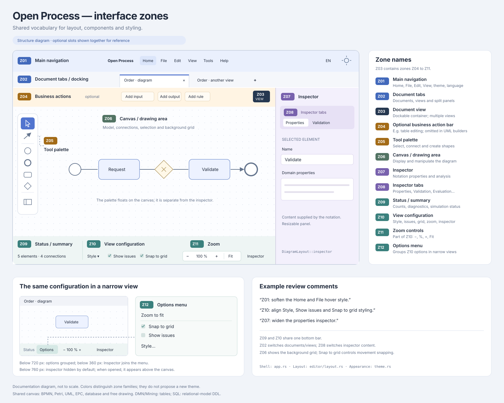

# Interface zones and components

**Status: implemented interface references and separate component-library proposals.**

Open the [annotated SVG](diagrams/interface-zones.svg) to refer to a zone by name
or ID, e.g. “Z10: change the Style button hover.” The editable vector document
has an identified group for each of twelve zones.

The diagram collects optional slots to give them names; a notation need not show
every component. Proportions/colors explain structure rather than propose moving
panels or adopting a new product theme.

The [visual identity guide](identite-graphique.md) describes the Classic
application/site styling, light/dark color modes, geometry and O → P signature. The
annotated diagram remains a structural reference.

## Shared vocabulary

| ID | Name | Role and owner |
| --- | --- | --- |
| Z01 | Main navigation / menu bar | Home, File, Edit, View, Tools, Help, language and theme. Shell: `app.rs::menu_bar`. |
| Z02 | Document tabs / docking | Open documents/views, closure and workspace splitting. `DockBehavior` in `app.rs`, tree in `dock.rs`. |
| Z03 | Document view / dockable panel | Container in the docking layout. Multiple views may share a model/history. |
| Z04 | Optional business action bar | Necessary notation-specific actions, such as table row editing. `DiagramLayout::tools`. UML does not show this bar. |
| Z05 | Tool palette | Active tool: select, connect, create. Notation content with `canvas.rs` primitives. |
| Z06 | Canvas / drawing area | Model rendering, background grid, selection, movement and camera. `DiagramLayout::canvas`. |
| Z07 | Inspector | Properties, validation or analysis. Frame/responsiveness: `DiagramLayout::inspector`. |
| Z08 | Inspector tabs | Switch Z07 content, e.g. Properties / Validation / Evaluation. `DiagramLayout::inspector_tabs`. |
| Z09 | Status / summary | Counts, diagnostics, simulation state. `FooterStatus` in `DiagramLayout::configuration`. |
| Z10 | View configuration | Style, Show issues, Snap to grid, zoom, inspector visibility. `DiagramLayout::configuration`. |
| Z11 | Zoom controls | Part of Z10: decrease, percentage/reset, increase, fit. `canvas::zoom_controls` and `zoom_buttons`. |
| Z12 | Compact Options menu | Groups Z10 options in narrow views; the same configuration component. |

Z09 and Z10 share **one bottom bar**, with Z11 inside Z10. Z02 changes the document
or view; Z08 changes inspector content. The Z06 grid is the canvas background,
while **Snap to grid** controls movement snapping.

Petri places use a model-space radius of 8.25 units, a diameter of 16.5 before
zoom, following the later 50% increase. Tokens scale with the radius; arc anchors,
creation previews and hit testing use it too. Labels retain their text size.
Historical radius changes in the verification record refer to earlier revisions.

The Z02 **+**, **File → New…** and **Ctrl/Cmd+N** open the same searchable,
scrollable, responsive grid of registry document cards. It reuses home components.
Choosing a card creates a document; cancellation/Escape closes the picker.
Creation preserves the originating tab group in split layouts.

Each document card has an **Examples** button at the bottom right with only that
type's examples. Home and picker use the same component. Cards without examples
and workflow launchers retain their primary action. Choosing an example closes
the picker and preserves the tab group; opening the menu creates no blank document.
Editors do not duplicate this **Examples** menu; process-discovery sample logs
are opened from their cards alongside the other notation examples.

On home, **Resume your work** precedes **New document** when documents are open.
Cards show a PNG preview, a one-line name with full hover text, type/icon and
unsaved status. Click/keyboard activation resumes the same document/history.
The responsive grid uses one to four columns.
**Saved diagrams** uses the same preview cards for closed automatic copies.
Their previews survive closing tabs and restarting the app; matching names do
not share images. Opening a saved card resumes that copy.

Home content stays centered with a maximum width of 1120 logical pixels. Its
vertical scroll area spans the available window width, keeping the scrollbar
at the right edge rather than beside the centered cards.

Previews are local captures of displayed content, reduced to 320 × 180 pixels
with aspect ratio preserved. They do not modify models/cameras and restore from
a separate bounded cache. Missing previews fall back to notation icons.

Notation/workflow icons come from descriptor functions rather than card position.
The free-drawing palette uses accessible icon buttons, floating left of the canvas
like BPMN/Petri, with vertical scrolling when needed. Graphical editors reuse the
shared selection cursor from `icons.rs`.

BPMN **Task type**/**Gateway type** context menus and corresponding inspector lists
use standard buttons with decorative icons and highlight the active type. Task
markers and gateway drawings match the canvas. Empty-space creation menu actions
also have icons. Full buttons remain clickable, with accessible labels; icons
follow text color for theme/selection.

Z01 groups exports in **File → Export**, populated by the active session, with
PNG where capture is supported. Exports are disabled on home.
The BPMN, Petri, EPC and UML format lists include Mermaid source and Mermaid
Markdown. These [exports](export-formats.md) add no canvas toolbar buttons.
Their **Tools → Convert to Mermaid** command opens a separate Mermaid document
with the same projection and conversion notes.

Graph notations (BPMN, Petri nets, EPC, UML activity, flowcharts, UML class and
use-case diagrams, database schemas) offer **Auto arrange** in Z10; it moves into
Z12 in compact views, is hidden in exam mode and is also available under Tools.
Free drawing, Mermaid, DMN and event logs do not offer it. Processes, Petri nets
and schemas grow left to right: forward flows go right, only loops return left,
and branches are stacked only where they occur. Class diagrams place parents
above children. Use cases stay inside their system boundary, which is resized
around them; actors come first. The layout is deterministic and is one undoable
step that fits the active view.

For BPMN, the layout also preserves pool/lane membership; message flows and
associations order columns across pools and next to documented elements. Loop
flows in the orthogonal style go around the elements in between, above or below,
instead of crossing them. Rows align node centers across different shape sizes. When **Snap to grid** is enabled, those centers and the
pool/lane geometry use the editor's 10-unit grid; disabling it keeps free
coordinates. Node sizes are preserved. Flow endpoints are recalculated from the
placed shapes: side midpoints on rectangles, vertices on gateways and the
boundary of circular events, rather than rounded away from their shapes.
Geometry is persistent/undoable; pool widths/lane heights may grow to fit
content and snapping clearance. Invalid geometry and ambiguous header
containment are diagnosed before mutation.

In BPMN's selection tool, hovering a pool border shows a horizontal/vertical
resize cursor; its four corners show the appropriate diagonal cursor. Dragging
works without selecting the pool first. A highlighted edge marks the active
target, with a constant screen-space hit tolerance at every zoom level.
Dragging an internal lane separator uses the vertical cursor and redistributes
height between the two adjacent lanes while keeping the overall pool height
and other lanes fixed. The top/bottom pool edges change the first/last lane.
Elements retain their positions; shrinking stops at their bounds and the normal
minimum sizes. Resizing honors snapping and forms one undo step; Escape cancels
the gesture. Pool headers still move the pool with its elements, and Space-drag
still pans the canvas.

All resizable canvas elements use the same border/corner interaction in BPMN,
UML class/use-case diagrams (including actors and system boundaries), EPC,
UML activities, database schemas and free drawings. The selection tool can grab
an element's bounding-box edges/corners without selecting it first. The cursor
indicates the moving direction and the active edge is highlighted. The opposite
edge remains fixed, and the pointer's initial offset prevents jumps when grabbing
near a border. Size limits remain notation-specific; class compartments and table
rows set minimum visible heights. Snap settings, one-step undo/redo and Escape
cancellation apply in every editor. Lines/arrows in free drawings retain their
endpoint handles and show an endpoint-editing cursor. Resize feedback is omitted
from exported images.

UML class and use-case builders group relation types in the floating **Connect**
tool (Z05). Hover or activate the tool to open a menu with an icon and translated
name for each valid relation type. The selected type becomes the tool's icon;
**C** reuses it after switching tools. The menu also supports keyboard activation,
Escape and dismissal when the pointer leaves the tool/menu. Choosing a type
clears an unfinished connection without changing the document or its history.
Create relations by dragging between nodes or clicking the two endpoints.

UML has no horizontal business action bar. For multiple selected nodes,
**Arrange** is available in the inspector and the canvas context menu. Duplication
remains in the context menu and **Ctrl/Cmd+D**. UML class conversion to Mermaid
is available in **Tools** and the canvas context menu, including narrow views;
exam mode hides it. These actions retain their existing undo/conversion behavior.

Graphical builders share copy/cut/paste, duplicate and select-all actions in
**Edit** and their canvas context menu: BPMN, Petri, UML classes/use cases, EPC,
activities, native flowcharts and database schemas. Use **Ctrl/Cmd+C**, **X**,
**V**, **D** and **A**, respectively. Hold **Alt** when starting a selection drag
to duplicate it; the copy and movement form one undo step, and **Escape** cancels
both. Copies retain internal links and receive fresh identifiers. Paste works
between documents of the same notation; unrelated clipboard text is ignored.
Petri mutation actions are unavailable during simulation.

Keyboard paste consumes system clipboard events on native and web builds.
Native menu paste requests the system clipboard; browser menu paste uses the
last selection copied within the application. Focused text fields retain their
own clipboard and undo behavior, even with the pointer above the canvas.

Free drawing retains its portable clipboard format, plain-text paste and
**Alt+drag** duplication, including pressing Alt during an existing move.
**Shift+drag** constrains movement/drawing. Its context menu also changes stacking
order. **F2**, Enter or double-click focuses the selected element's text in the
inspector. The shortcut help and [drawing guide](dessin-libre.md) list keyboard
equivalents and the browser menu-paste fallback.

These references cover BPMN, Petri, UML, EPC, database and [free drawing](dessin-libre.md).
Text/table views such as Mining must not simulate a canvas to fit the layout.
DMN shares actions/inspector with scrollable table content and no artificial zoom.
Database SQL is a secondary selectable-text view sharing the relational document.
[Mermaid](mermaid.md) uses Source/Builder/Templates inspector tabs and a graphical
preview where supported.

## Exam mode

**Tools → Exam mode** toggles assistance for the whole application, including
documents opened afterwards. A label in the navigation bar identifies the active
mode. It starts disabled on launch and is separate from saved document content.

The process-discovery editor replaces its former manual-mode selector with an
exam answer form: relation lists, an editable relation matrix and Alpha step
fields. There are no answer hints, checking/filling buttons, correctness colors,
scores, generated nets, replay results or solution-copy/export actions. Exam
preparation only parses activity names in a background job; it does not run Alpha
discovery or soundness. Answers still save and support undo/redo. Existing logs
retain their answers and legacy `manual` field when saved.

Other editors hide validation, evaluation and generated results. Petri
simulation, matrices, analysis, reachability, automatic layout, notation
conversions and SQL generation are unavailable. Already open result panes show
an assistance-disabled message, and their commands and shortcuts cannot reopen
the tools. Examples, workflow launchers, Mermaid templates and cached home
previews are hidden. Drawing, properties, navigation, undo/redo, `.opx` saving and
exports of authored diagrams remain available. Disabling exam mode restores
assistance without replacing the student's answers.

## Reusable layout and appearance

[editor/layout.rs](../crates/op-app/src/editor/layout.rs) owns editor arrangement.
Notations provide palettes, business actions, properties and specific options
rather than copying configuration bars, zoom, spacing or breakpoints.

Thresholds depend on **available view width**, including docking splits:

- Inspector on the right above 760 px; hidden by default below it. Explicitly
  opening it in a narrow view places a bounded panel above the canvas.
- Options grouped in Z12 below 720 px of bar width.
- Inspector button also grouped in Z12 below 360 px.

[theme.rs](../crates/op-app/src/theme.rs) owns reusable appearance.
`toolbar_style` shares transparent idle backgrounds, neutral hover, accent-tinted
selection, corner/glyph consistency and keyboard focus outlines across navigation,
business actions, inspector tabs and configuration. Form fields retain their
usual style. `DiagramLayout` determines placement; `theme.rs` determines appearance.
A future component kit would integrate into that common layer.

[canvas/resize.rs](../crates/op-app/src/canvas/resize.rs) owns shared screen-space
picking, grab offsets, directional cursors and highlights. The UI-independent
[geometry operation](../crates/op-core/src/geom/resize.rs) moves the requested
borders with supplied size limits and snapping. Editors retain typed targets,
models and histories; BPMN lane separators keep their domain-specific operation.

`theme::menu_style` gives popup buttons 10 px of horizontal and 4 px of vertical
padding, inside the shared 8 px menu frame margin. The main menu bar passes this
style to its dropdowns (including language) and nested menus. Other editor menus,
card examples and context menus apply the same style to their contents. Combo-box
lists retain the normal form-button padding.

## Rust component libraries: historical investigation

The app uses egui/eframe 0.37; see [Cargo.toml](../crates/op-app/Cargo.toml).
Controls are drawn by egui, not HTML elements accepting Tailwind/DaisyUI classes.
The following was a **13 November 2026 investigation**, not a current compatibility
certification. None of these kits was integrated or tested in the repository.

| Library | Potential use | Compatibility recorded at the time |
| --- | --- | --- |
| [egui-shadcn](https://docs.rs/crate/egui-shadcn/latest) | shadcn/ui-inspired buttons, fields, tabs, cards and variants. | Documented 0.5.0 depended on egui 0.33; adaptation needed for 0.37. |
| [egui-material3](https://docs.rs/crate/egui-material3/latest) | Material Design 3 components/themes. | Investigated 0.0.9 also depended on egui 0.33. |
| [shadcn-egui](https://docs.rs/shadcn-egui/latest/shadcn_egui/) | A separate shadcn/ui-inspired theme/component/font/icon project. | The [inspected manifest](https://github.com/oetiker/shadcn-egui/blob/main/Cargo.toml) used egui 0.34; 0.37 compatibility was not validated. |

Before selecting a kit, pin a version and exercise menus, docking, keyboard focus,
translations and native/WebAssembly builds. Types from different egui versions
are not directly interchangeable. Adoption remains a separate proposal to compare
with maintaining the small shared theme.

## Historical checks for the layout work

The SVG was parsed as XML, its twelve zone groups/unique IDs checked, then
rasterized and inspected. `app::tests::screenshots` generates local light/dark
hover captures for Home, File, Style and Inspector in `target/screenshots/`.
Recorded Rust/document checks are in
[verification](verification.md#interface-zones-and-style). See its later English
documentation section for checks of the translated diagram.
