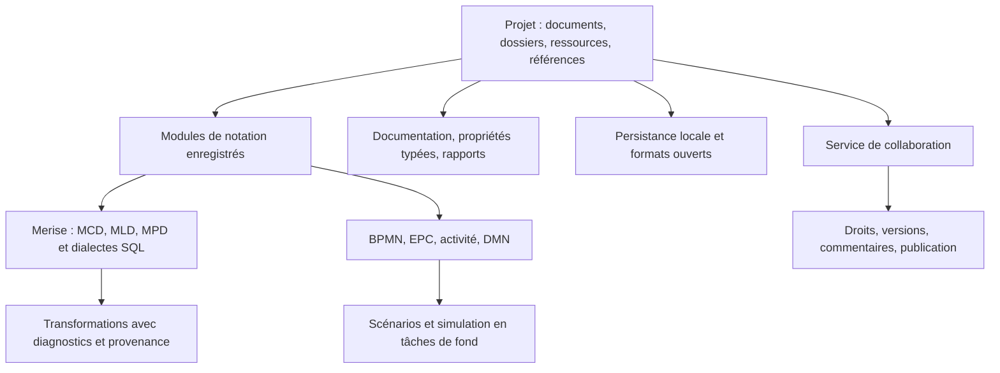

# Cible produit : Looping et Bizagi Modeler

**Orientation demandée le 13 novembre 2026 : couvrir les fonctions de Looping
et de Bizagi Modeler en priorité ; élargir ensuite vers Visual Paradigm.**

Cette page est un inventaire de la documentation publique des éditeurs et une
analyse du dépôt. Les logiciels concurrents n’ont pas été exécutés pour cette
étude. Les différences entre leurs éditions ou abonnements restent à vérifier
avant de promettre une équivalence commerciale. La cible inclut les fonctions
de modélisation, de publication et de collaboration de Modeler ; Studio,
l’exécution de workflows et les applications low-code constituent un autre produit.

## Lecture et sources

Les statuts portent sur Open Process : **présent**, **partiel**, **à réaliser** ou
**à vérifier**. Une famille partielle n’est pas annoncée comme équivalente au
produit de référence. Les critères ci-dessous sont nos critères de réception,
pas des engagements de performance des éditeurs.

Sources primaires consultées le 13 novembre 2026 :

- **L1** — [Looping : fonctionnalités](https://www.looping.fr/tab-spec.html).
- **L2** — [Looping : nouveautés 4.1 et préparation de 4.2](https://www.looping.fr/tab-nouv.html).
- **L3** — [Looping : accueil, version et exemples de modèles](https://www.looping-mcd.fr/).
- **B1** — [Bizagi Modeler : présentation du service](https://help.bizagi.com/platform/en/intro_welcome.htm).
- **B2** — [Bizagi Modeler : ruban et commandes](https://help.bizagi.com/platform/en/the_ribbon.htm).
- **B3** — [Bizagi Modeler : niveaux de simulation](https://help.bizagi.com/platform/en/simulation_levels.htm).
- **B4** — [Bizagi Modeler : ressources](https://help.bizagi.com/platform/en/level_3_example.htm).
- **B5** — [Bizagi Modeler : scénarios](https://help.bizagi.com/platform/en/scenarios.htm).
- **B6** — [Bizagi Modeler : types d’attributs étendus](https://help.bizagi.com/platform/en/extended_attributes_type.htm).
- **B7** — [Bizagi Modeler : bibliothèque de processus](https://help.bizagi.com/platform/en/process_library.htm).
- **B8** — [Bizagi Modeler : fonctions du client de bureau](https://help.bizagi.com/platform/en/desktop-application.htm).
- **B9** — [Bizagi Modeler : documentation et échanges](https://help.bizagi.com/platform/en/diagramming_and_documenting_fa.htm).
- **B10** — [Bizagi Modeler : fonctionnement et limites de simulation](https://help.bizagi.com/platform/en/simulation_in_bizagi.htm).
- **B11** — [Bizagi Modeler : attributs partagés](https://help.bizagi.com/platform/en/subscription_extattrib_enter.htm).
- **V1** — [Visual Paradigm : catalogue fonctionnel](https://www.visual-paradigm.com/features/), consulté pour l’horizon suivant.

Les deux onglets de Looping sont chargés dans une iframe depuis l’accueil ; ils
ont été lus directement. Sa page annonce la version **4.1, datée du 7 mars 2025**.
L’interface trilingue évoquée pour 4.2 est une préparation annoncée, pas une
fonction de la version 4.1. [Source L3](https://www.looping-mcd.fr/),
[source L2](https://www.looping.fr/tab-nouv.html).

## Looping : matrice de couverture

Les capacités de conception et de génération proviennent de
[L1](https://www.looping.fr/tab-spec.html) ; les évolutions 4.1 de
[L2](https://www.looping.fr/tab-nouv.html).

| ID | Capacité de référence | Open Process | Critère de réception proposé |
| --- | --- | --- | --- |
| L01 | Entités / associations | À réaliser | Modèle Merise typé ; associations binaires, réflexives et n-aires avec cardinalités testées. |
| L02 | Diagrammes de classes | Partiel | Classificateurs et relations présents ; rapprocher leur sémantique du modèle de données. |
| L03 | Entités fictives | À réaliser | Élément conceptuel exclu de la génération avec diagnostic explicite. |
| L04 | Identifiants relatifs / transformation d’association | À réaliser | Préserver les identifiants et les dépendances dans les transformations. |
| L05 | Propriétés et types | Partiel | Colonnes SQL structurées présentes ; attributs/domaines Merise et liaison avec UML à développer. |
| L06 | Généralisation / spécialisation | Partiel | Héritage UML présent ; stratégies de génération Merise et SQL à définir. |
| L07 | CIF et contraintes inter-associations | À réaliser | Contraintes typées, portée et validation propres à Merise. |
| L08 | Règles de gestion / SQL | À réaliser | Règles attachées au modèle et traçables dans le code produit. |
| L09 | Textes, images, graphiques et flux | Partiel | Annotations disponibles dans certaines notations ; documenter et compléter les objets libres. |
| L10 | MLD immédiat | À réaliser | Conversion déterministe, explication de chaque table, clé et migration. |
| L11 | DDL immédiat | Partiel | Aperçu relationnel et export SQL implémentés ; génération depuis un MCD encore absente. |
| L12 | Plusieurs SGBD | Partiel | PostgreSQL, MySQL/MariaDB et SQLite implémentés ; SQL Server, Oracle et essais serveurs restent à compléter. |
| L13 | SGBD personnalisé | À réaliser | Profils de types et règles de génération versionnés et validés. |
| L14 | Images et presse-papiers | Partiel | PNG présent pour les canvas, SVG pour EPC/activité ; compléter les formats et le futur MCD. |
| L15 | Vues et zooms multiples | Présent pour les canvas | Plusieurs panneaux du même document, caméra et inspecteur indépendants, historique partagé. |
| L16 | Présentation personnalisable | Partiel | Thèmes et styles de liens présents ; couleurs, fontes et présentation par élément à compléter. |
| L17 | Rétroconception DDL | À réaliser | SQL → modèle physique → MCD proposé, avec limites et pertes signalées. |
| L18 | Défilement horizontal au clavier / à la molette | À vérifier | Tester explicitement Maj + molette, pavé tactile et navigateur. |
| L19 | Couleurs de sélection multiple et des liens | Partiel | Sélection multiple existante selon la notation ; édition collective de couleurs absente. |
| L20 | Noms d’index dans le MCD | Partiel | Index structurés dans le schéma relationnel ; affichage dans un futur MCD absent. |
| L21 | NOT NULL et UNIQUE | Partiel | Contraintes relationnelles et SQL implémentés ; modèle conceptuel et réimport restent à développer. |
| L22 | Masquage des marqueurs conceptuels | À réaliser | Nom métier et nom physique séparés ; affichage configurable. |
| L23 | Migration des attributs hérités | À réaliser | Stratégies d’héritage testées, sans perte silencieuse. |
| L24 | Snake / Camel / Pascal | À réaliser | Politique de nommage, collisions, accents et mots réservés testés. |
| L25 | Contraintes en ALTER TABLE | Partiel | Clés étrangères après les tables pour PostgreSQL/MySQL, avec cycles ; option générale de placement à compléter. |
| L26 | Présentation simplifiée des CIF | À réaliser | Option de vue indépendante de la contrainte persistante. |
| L27 | Optimisations multi-CIF / K(PK) | À étudier | Formaliser les règles annoncées avant d’affirmer une équivalence algorithmique. |
| L28 | Modèles organisationnels de flux | À réaliser | Acteurs, échanges et liens vers les données du projet. Exemples publiés en L3. |

Le chantier indispensable est donc la chaîne **MCD → MLD → MPD/SQL**, avec la
rétroconception en retour. Les diagrammes de classes déjà présents constituent
un point d’appui ; ils ne remplacent pas un modèle Merise avec ses invariants.
La première [implémentation relationnelle et DDL](base-de-donnees-ddl.md) fournit
désormais les tables physiques et les générateurs de trois profils de SGBD.

## Bizagi Modeler : matrice de couverture

La documentation distingue le client de bureau et les services de bibliothèque
et de gouvernance. Les fonctions cloud font partie de la cible demandée ; leur
réalisation nécessite un service serveur en plus de l’application native/Wasm.
[B1](https://help.bizagi.com/platform/en/intro_welcome.htm),
[B8](https://help.bizagi.com/platform/en/desktop-application.htm).

| ID | Capacité de référence | Open Process | Critère de réception proposé | Source |
| --- | --- | --- | --- | --- |
| B01 | Modélisation BPMN | Partiel | Couverture détaillée des éléments et attributs, sans annoncer le sous-ensemble pédagogique comme BPMN complet. | B1, B2 |
| B02 | Pools, lanes et jalons | Partiel | Pools/lanes présents ; ajouter les jalons et tester leurs déplacements avec le contenu. | B2 |
| B03 | Sous-processus et réutilisation | Partiel | Le nœud SubProcess existe ; développer contenu, navigation, appels et références entre diagrammes. | B9 |
| B04 | Validation de modèle | Partiel | Règles présentes ; compléter les contraintes et la navigation vers tous les diagnostics. | B2 |
| B05 | Presse-papiers et variantes de collage | Partiel | Vérifier chaque notation, les conteneurs, les flux et la conservation du style. | B2 |
| B06 | Alignement et distribution | Partiel | Fonctions UML présentes ; mutualiser les gestes pour les autres éditeurs compatibles. | B2 |
| B07 | Mise en forme | Partiel | Couleurs, fontes, alignement du texte et réinitialisation doivent être modifiables par élément. | B2 |
| B08 | Recherche | À réaliser | Noms, documentation, attributs et résultats navigables. | B2, B7 |
| B09 | Correction orthographique | À réaliser | Service optionnel par langue, distinct de la validation métier. | B2 |
| B10 | Documentation enrichie | Partiel | Champ documentaire BPMN présent ; ajouter texte enrichi et structuration. | B9 |
| B11 | Ressources et responsabilités | À réaliser | Répertoire de rôles, personnes et systèmes, affectations réutilisables et matrices RACI. | B2, B4 |
| B12 | Attributs étendus | À réaliser | Types texte, nombre, date, image, sélection simple/multiple, fichiers, URL et table. | B6 |
| B13 | Attributs partagés | À réaliser | Définitions de propriétés partagées, versionnées et importables. | B11 |
| B14 | Pièces jointes et références | À réaliser | Ressources incorporées ou liées, avec résolution portable et chemins sûrs. | B6, B8 |
| B15 | Simulation : validation | À réaliser pour BPMN | Animation de jetons BPMN, arrivées et comptage ; le jeu de jetons Petri est une autre fonction. | B3, B10 |
| B16 | Simulation : temps | Partiel | Évaluation analytique de processus structurés présente ; simulation avec arrivées et distributions absente. | B3 |
| B17 | Simulation : ressources / coûts | À réaliser | Capacités, affectations, attentes, utilisation et coûts observables. | B4 |
| B18 | Simulation : calendriers | À réaliser | Plages de travail, indisponibilités et ressources à horaires distincts. | B3 |
| B19 | Scénarios et what-if | À réaliser | Scénarios séparés du modèle, réplications, graines et comparaison des résultats. | B5 |
| B20 | Résultats de simulation | À réaliser | Indicateurs par activité/ressource et exports tabulaires ; ne pas confondre avec les matrices Petri. | B4, B10 |
| B21 | Échanges BPMN | Partiel | XML avec géométrie déjà présent ; mesurer les pertes avec un corpus réel de Modeler. | B2, B9 |
| B22 | Échanges XPDL | À réaliser | Import/export avec diagnostics sur les constructions non représentables. | B2, B9 |
| B23 | Échanges Visio | À réaliser | Définir précisément les variantes de format acceptées et tester des fichiers sources. | B2, B9 |
| B24 | Fichiers Bizagi et attributs XML | À réaliser | Étudier les formats et leurs versions ; aucune compatibilité `.bpm` annoncée aujourd’hui. | B2 |
| B25 | Export image | Partiel | PNG présent ; couvrir export complet, résolution, fond et formats supplémentaires. | B2 |
| B26 | Publication Word / PDF / Excel | À réaliser | Documents complets incluant diagrammes, propriétés et pièces jointes référencées. | B2 |
| B27 | Publication web / SharePoint / Wiki | À réaliser | D’abord un paquet HTML autonome, puis des adaptateurs de publication. | B2 |
| B28 | Modèles de rapport et identité | À réaliser | Modèles de documents configurables, styles et logo de l’organisation. | B1, B9 |
| B29 | Organisation en modèles et dossiers | À réaliser | Projet contenant plusieurs documents et ressources, avec références stables. | B8 |
| B30 | Répertoire cloud et droits | À réaliser | Authentification, autorisations sur modèles, stockage, sauvegarde et reprise hors ligne. | B1, B8 |
| B31 | Commentaires et réponses | À réaliser | Discussions rattachées au projet, diagramme ou élément avec identifiants persistants. | B8 |
| B32 | Verrouillage d’édition | À réaliser | Réservation/libération et gestion des conflits ; ne pas assimiler cela à une coédition temps réel. | B2, B8 |
| B33 | Activité et notifications | À réaliser | Journal d’événements et notifications selon les droits. | B8 |
| B34 | Versions publiées | À réaliser | Instantanés persistants, comparaison et restauration ; l’undo local ne suffit pas. | B7 |
| B35 | Chaîne de valeur | À réaliser | Cartographie avec accès aux processus et hiérarchie du référentiel. | B7 |
| B36 | Publication et conformité | À réaliser | Lecture certifiée, rôles, versions approuvées et diffusion contrôlée. | B7 |
| B37 | Statistiques de consultation | À réaliser | Mesures d’usage du portail et exports définis. | B7 |
| B38 | Découverte depuis des journaux | Partiel | Import XES/CSV/texte et Alpha présents ; mesurer les écarts fonctionnels et de robustesse. | B2 |

La simulation de Modeler possède elle-même des limites publiées. La cible
d’Open Process doit définir explicitement les constructions prises en charge
et refuser un calcul hors périmètre plutôt que produire un résultat trompeur.
[B10](https://help.bizagi.com/platform/en/simulation_in_bizagi.htm).

## Architecture nécessaire à cette cible

Conserver le [monolithe modulaire](architecture-cible.md) et les modèles typés.
Ajouter des frontières au fur et à mesure que les fonctionnalités les nécessitent :

- **Un modèle métier et plusieurs vues** : le MLD/SQL dérivé référence les éléments
  du MCD source. Les conversions destructrices créent un nouveau document et
  des diagnostics ; elles ne réécrivent pas discrètement la source.
- **Projet au-dessus des documents** : nouvelle enveloppe de projet et migrations,
  sans rendre les anciens `.opx` unitaires illisibles. Une référence interdocument
  porte un identifiant stable ; un chemin de fichier n’est pas une identité métier.
- **Données structurées** : attributs, domaines, cardinalités, contraintes et
  propriétés étendues sont des types Rust ; ils ne deviennent pas des chaînes
  interprétées différemment dans chaque panneau.
- **Couche SQL indépendante** : modèle relationnel intermédiaire, transformation
  Merise, adaptateurs de dialectes et parseurs SQL séparés. Ne pas exécuter un
  SQL importé pour en extraire sa structure.
- **Services communs de présentation** : `DiagramLayout`, thème, sélection,
  interactions et exports réutilisables ; symboles, règles et algorithmes restent
  la responsabilité des notations.
- **Calculs annulables** : transformations lourdes, simulation et rétroconception
  utilisent les tâches de fond natives/Web Workers avec gestion des résultats périmés.
- **Serveur distinct pour la collaboration** : garder le travail local autonome ;
  définir ensuite API, identité, droits, révisions et résolution de conflits.
  L’application Wasm existante ne constitue pas à elle seule ce serveur.

## Ordre de réalisation proposé

Les lots ci-dessous décrivent le travail restant. Leur réception repose sur les
scénarios et les tests de compatibilité ; aucune durée n’a été estimée.

| Lot | Livrable | Réception minimale |
| --- | --- | --- |
| 0 — Extensions confirmées | DMN, EPC et UML activité | Premières versions décrites dans [notations ajoutées](notations-ajoutees.md), avec limites explicites. |
| 1 — Socle Looping | MCD, attributs, domaines, cardinalités et contraintes de base | Concevoir un cas commandes/clients/lignes, le valider, annuler et rouvrir le modèle. |
| 2 — Génération | MLD, MPD, SQL et politiques de nommage | Éditeur relationnel et trois profils DDL initiaux présents ; dérivation Merise et nommage à poursuivre. SQL exécuté avec SQLite. |
| 3 — Looping avancé | Héritage, identifiants relatifs, CIF et rétroconception | Corpus incluant n-aires, réflexivité, dépendances et cycles de clés étrangères. |
| 4 — Édition et échanges Modeler | Couverture BPMN, sous-processus, presse-papiers, recherche et imports | Corpus de modèles de référence avec diagnostics explicites de conversion. |
| 5 — Documentation | Propriétés typées, ressources, RACI, pièces jointes et rapports | Produire un dossier exploitable en HTML, PDF, Word et Excel à partir d’un même modèle. |
| 6 — Simulation Modeler | Jetons, temps, ressources, calendriers, scénarios et résultats | Cas de référence déterministes, mêmes graines, calculs reproductibles et annulation web. |
| 7 — Référentiel partagé | Projet, bibliothèque, droits, commentaires, versions et gouvernance | Travail concurrent, restauration, contrôle d’accès et publication sur un serveur de test. |
| 8 — Extension Visual Paradigm | Catalogue plus large et ingénierie | Sélection dans [le catalogue proposé](catalogue-diagrammes.md), après les lots prioritaires. |

Pour revendiquer la parité, fermer les lignes de couverture avec une preuve
reproductible. Un simple item de menu, un export syntaxiquement valide ou une
capture ne suffit pas à valider une fonction métier complète.
