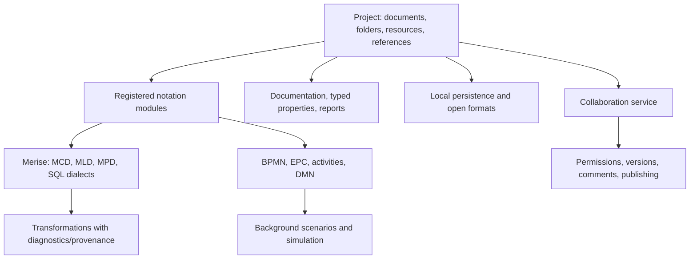

# Product goals: Looping and Bizagi Modeler

**Direction requested on 13 November 2026: prioritize Looping and Bizagi Modeler
capabilities, then broaden toward Visual Paradigm.**

This is an inventory of vendor documentation and a repository analysis. Competing
applications were not run for the study. Edition/subscription differences require
verification before promising commercial equivalence. The target includes Modeler
modelling, publishing and collaboration; Studio, workflow execution and low-code
applications are separate products.

## Reading the matrix and sources

Statuses describe Open Process: **present**, **partial**, **planned**, **needs
verification**. Partial families are not equivalent to the reference product.
Acceptance criteria are our proposals, not vendor performance commitments.

Primary sources consulted in the historical study on **13 November 2026**:

- **L1** — [Looping features](https://www.looping.fr/tab-spec.html).
- **L2** — [Looping 4.1 changes and 4.2 preparation](https://www.looping.fr/tab-nouv.html).
- **L3** — [Looping home, version and examples](https://www.looping-mcd.fr/).
- **B1** — [Bizagi Modeler introduction](https://help.bizagi.com/platform/en/intro_welcome.htm).
- **B2** — [Ribbon and commands](https://help.bizagi.com/platform/en/the_ribbon.htm).
- **B3** — [Simulation levels](https://help.bizagi.com/platform/en/simulation_levels.htm).
- **B4** — [Resources](https://help.bizagi.com/platform/en/level_3_example.htm).
- **B5** — [Scenarios](https://help.bizagi.com/platform/en/scenarios.htm).
- **B6** — [Extended attribute types](https://help.bizagi.com/platform/en/extended_attributes_type.htm).
- **B7** — [Process library](https://help.bizagi.com/platform/en/process_library.htm).
- **B8** — [Desktop application features](https://help.bizagi.com/platform/en/desktop-application.htm).
- **B9** — [Documentation and exchange](https://help.bizagi.com/platform/en/diagramming_and_documenting_fa.htm).
- **B10** — [Simulation behavior and limits](https://help.bizagi.com/platform/en/simulation_in_bizagi.htm).
- **B11** — [Shared attributes](https://help.bizagi.com/platform/en/subscription_extattrib_enter.htm).
- **V1** — [Visual Paradigm features](https://www.visual-paradigm.com/features/), for the later horizon.

Looping's two tabs were read directly from their iframe URLs. At the time, the
site advertised **4.1, dated 7 March 2025**. The trilingual interface announced
for 4.2 was preparatory work, not a 4.1 feature. These are dated observations,
not a fresh vendor/version audit for the English documentation update.
[Source L3](https://www.looping-mcd.fr/), [source L2](https://www.looping.fr/tab-nouv.html).

## Looping coverage

Design/generation features come from [L1](https://www.looping.fr/tab-spec.html);
4.1 changes from [L2](https://www.looping.fr/tab-nouv.html).

| ID | Reference capability | Open Process | Proposed acceptance criterion |
| --- | --- | --- | --- |
| L01 | Entities / associations | Planned | Typed Merise model; tested binary, reflexive and n-ary associations/cardinalities. |
| L02 | Class diagrams | Partial | Existing classifiers/relations; connect their semantics to data modelling. |
| L03 | Fictitious entities | Planned | Conceptual element excluded from generation, with explicit diagnostics. |
| L04 | Relative identifiers / association transformation | Planned | Preserve identifiers/dependencies through transformations. |
| L05 | Properties and types | Partial | Structured SQL columns present; Merise attributes/domains and UML links remain. |
| L06 | Generalization / specialization | Partial | UML inheritance exists; define Merise/SQL generation strategies. |
| L07 | Inter-association integrity constraints (CIF) | Planned | Typed constraints with Merise-specific scope/validation. |
| L08 | Business rules / SQL | Planned | Model-attached rules traceable into generated code. |
| L09 | Text, images, graphics and flows | Partial | Annotations/free drawing cover some uses; complete free objects across notations. |
| L10 | Immediate logical model (MLD) | Planned | Deterministic conversion explaining tables, keys and migrations. |
| L11 | Immediate DDL | Partial | Relational preview/SQL export present; generation from MCD absent. |
| L12 | Multiple DBMSs | Partial | PostgreSQL, MySQL/MariaDB and SQLite present; SQL Server, Oracle and server trials remain. |
| L13 | Custom DBMS | Planned | Versioned/validated type profiles and generation rules. |
| L14 | Images and clipboard | Partial | Canvas PNG and some SVG exports; extend formats and future MCD. |
| L15 | Multiple views and zooms | Present for canvases | Shared model/history with independent cameras/inspectors. |
| L16 | Custom presentation | Partial | Themes/link styles present; extend per-element colors/fonts/presentation. |
| L17 | DDL reverse engineering | Planned | SQL → physical model → proposed MCD, with losses/limits reported. |
| L18 | Keyboard/wheel horizontal scrolling | Needs verification | Explicit Shift+wheel, touchpad and browser checks. |
| L19 | Multi-selection and link colors | Partial | Multi-selection and whiteboard style editing exist; broader notation coverage remains. |
| L20 | Index names in conceptual models | Partial | Structured relational indexes present; future MCD display absent. |
| L21 | NOT NULL and UNIQUE | Partial | Relational constraints/SQL present; conceptual modelling/reimport remain. |
| L22 | Hide conceptual markers | Planned | Separate business/physical names and configurable display. |
| L23 | Inherited attribute migration | Planned | Tested inheritance strategies without silent loss. |
| L24 | Snake / Camel / Pascal naming | Planned | Tested naming policies, collisions, accents and reserved words. |
| L25 | ALTER TABLE constraints | Partial | PostgreSQL/MySQL foreign keys follow tables, including cycles; general placement options remain. |
| L26 | Simplified CIF display | Planned | View preference independent of persistent constraints. |
| L27 | Multi-CIF / K(PK) optimizations | To investigate | Formalize claimed rules before asserting algorithmic equivalence. |
| L28 | Organizational flow models | Planned | Actors/exchanges linked to project data; examples in L3. |

The essential pipeline is **MCD → MLD → MPD/SQL**, plus reverse engineering.
Existing class diagrams are a foundation, not a substitute for Merise invariants.
The initial [relational/DDL implementation](base-de-donnees-ddl.md) supplies physical
tables and three DBMS profiles.

## Bizagi Modeler coverage

Vendor documentation distinguishes the desktop client from library/governance
services. Cloud functions are part of the requested product direction and need a
server beyond the native/Wasm app. [B1](https://help.bizagi.com/platform/en/intro_welcome.htm),
[B8](https://help.bizagi.com/platform/en/desktop-application.htm).

| ID | Reference capability | Open Process | Proposed acceptance criterion | Source |
| --- | --- | --- | --- | --- |
| B01 | BPMN modelling | Partial | Detailed element/attribute coverage without calling the educational subset complete BPMN. | B1, B2 |
| B02 | Pools, lanes and milestones | Partial | Pools/lanes present; add milestones and test movement with contents. | B2 |
| B03 | Subprocesses and reuse | Partial | SubProcess node exists; content, navigation, calls and cross-diagram references remain. | B9 |
| B04 | Model validation | Partial | Rules present; extend constraints and navigation to diagnostics. | B2 |
| B05 | Clipboard and paste variants | Partial | Check notations, containers, flows and style preservation. | B2 |
| B06 | Alignment and distribution | Partial | UML features exist; share gestures across compatible editors. | B2 |
| B07 | Formatting | Partial | Extend per-element colors, fonts, text alignment and reset. | B2 |
| B08 | Search | Planned | Navigable names, documentation, attributes and results. | B2, B7 |
| B09 | Spell checking | Planned | Optional language service separate from domain validation. | B2 |
| B10 | Rich documentation | Partial | BPMN documentation field exists; rich text/structure remain. | B9 |
| B11 | Resources and responsibilities | Planned | Reusable roles/people/systems, assignments and RACI matrices. | B2, B4 |
| B12 | Extended attributes | Planned | Text, number, date, image, single/multiple choice, file, URL and table types. | B6 |
| B13 | Shared attributes | Planned | Shared, versioned, importable property definitions. | B11 |
| B14 | Attachments and references | Planned | Embedded/linked resources with portable resolution and safe paths. | B6, B8 |
| B15 | Simulation: validation | Planned for BPMN | BPMN tokens, arrivals and counts; Petri token play is separate. | B3, B10 |
| B16 | Simulation: time | Partial | Structured analytical evaluation exists; arrivals/distributions simulation absent. | B3 |
| B17 | Simulation: resources / costs | Planned | Capacities, assignments, queues, utilization and observable costs. | B4 |
| B18 | Simulation: calendars | Planned | Work periods, downtime and separate resource schedules. | B3 |
| B19 | Scenarios and what-if | Planned | Model-independent scenarios, replications, seeds and comparisons. | B5 |
| B20 | Simulation results | Planned | Activity/resource metrics and tabular exports, distinct from Petri matrices. | B4, B10 |
| B21 | BPMN exchange | Partial | XML/geometry present; measure losses with a real Modeler corpus. | B2, B9 |
| B22 | XPDL exchange | Planned | Import/export with diagnostics for unrepresentable constructs. | B2, B9 |
| B23 | Visio exchange | Planned | Define accepted format variants and test source files. | B2, B9 |
| B24 | Bizagi files and XML attributes | Planned | Investigate formats/versions; no current `.bpm` compatibility claim. | B2 |
| B25 | Image export | Partial | PNG present; extend full-diagram export, resolution, background and formats. | B2 |
| B26 | Word / PDF / Excel publishing | Planned | Complete documents with diagrams, properties and attachment references. | B2 |
| B27 | Web / SharePoint / Wiki publishing | Planned | Standalone HTML package first, then publication adapters. | B2 |
| B28 | Report templates and branding | Planned | Configurable templates, styles and organization logo. | B1, B9 |
| B29 | Models and folders | Planned | Multi-document/resource projects with stable references. | B8 |
| B30 | Cloud repository and permissions | Planned | Authentication, model permissions, storage, backups and offline recovery. | B1, B8 |
| B31 | Comments and replies | Planned | Discussions on project/diagram/element with persistent IDs. | B8 |
| B32 | Editing locks | Planned | Reservation/release and conflicts, distinct from real-time coediting. | B2, B8 |
| B33 | Activity and notifications | Planned | Permission-aware event log/notifications. | B8 |
| B34 | Published versions | Planned | Persistent snapshots, comparison/restoration; local undo is insufficient. | B7 |
| B35 | Value chain | Planned | Process access and repository hierarchy. | B7 |
| B36 | Publication and compliance | Planned | Certified reading, roles, approved versions and controlled distribution. | B7 |
| B37 | Viewing statistics | Planned | Defined portal usage metrics/exports. | B7 |
| B38 | Discovery from logs | Partial | XES/CSV/text and Alpha present; measure capability/robustness gaps. | B2 |

Modeler also publishes simulation limits. Open Process must define supported
constructs explicitly and reject out-of-scope calculations rather than produce
misleading results. [B10](https://help.bizagi.com/platform/en/simulation_in_bizagi.htm).

## Architecture needed for this goal

Keep the [modular monolith](architecture-cible.md) and typed models. Add boundaries
as features require them; the following is a proposal, not the current implementation:

- **One domain model, multiple views:** derived MLD/SQL references source MCD
  elements. Destructive conversions create new documents/diagnostics rather than
  silently rewriting sources.
- **Projects above documents:** introduce a project envelope/migrations while
  preserving standalone `.opx`. Stable IDs identify cross-document references;
  file paths are not domain identity.
- **Structured data:** attributes, domains, cardinalities, constraints and extended
  properties remain Rust types rather than panel-specific interpreted strings.
- **Independent SQL layer:** separate intermediate relational model, Merise
  transformation, dialect adapters and SQL parsers. Never execute imported SQL to
  infer its structure.
- **Common presentation services:** reuse `DiagramLayout`, theme, selection,
  interactions and exports; symbols/rules/algorithms remain notation-owned.
- **Cancellable computation:** expensive transformations, simulation and reverse
  engineering use native jobs/Web Workers with stale-result handling.
- **Separate collaboration server:** preserve autonomous local work, then define
  APIs, identity, permissions, revisions and conflict resolution. The Wasm app
  alone is not that server.

## Proposed delivery order

These stages describe goals and remaining work, with scenario/compatibility-based
acceptance and no delivery-time estimates.

| Stage | Deliverable | Minimum acceptance |
| --- | --- | --- |
| 0 — Confirmed extensions | DMN, EPC, UML activity | Initial versions in [the notation guide](notations-ajoutees.md), with explicit limits. |
| 1 — Looping foundation | MCD, attributes, domains, cardinalities, basic constraints | Model/validate/undo/reopen a customer/order/item case. |
| 2 — Generation | MLD, MPD, SQL, naming policies | Initial relational editor/three DDL profiles exist; Merise derivation/naming remain. Execute SQL with SQLite. |
| 3 — Advanced Looping | Inheritance, relative IDs, CIF, reverse engineering | Corpus with n-ary/reflexive associations, dependencies and foreign-key cycles. |
| 4 — Modeler editing/exchange | BPMN, subprocesses, clipboard, search, imports | Reference corpus with explicit conversion diagnostics. |
| 5 — Documentation | Typed properties, resources, RACI, attachments, reports | Usable HTML/PDF/Word/Excel from one model. |
| 6 — Modeler simulation | Tokens, time, resources, calendars, scenarios, results | Deterministic reference cases, seeds, reproducibility and browser cancellation. |
| 7 — Shared repository | Projects, library, permissions, comments, versions, governance | Concurrent work, recovery, access control and publication on a test server. |
| 8 — Visual Paradigm expansion | Broader catalogue and engineering | Select from [the proposed catalogue](catalogue-diagrammes.md) after priorities. |

Claim parity only when coverage rows have reproducible evidence. A menu item,
syntactically valid export or screenshot does not establish a complete domain capability.
